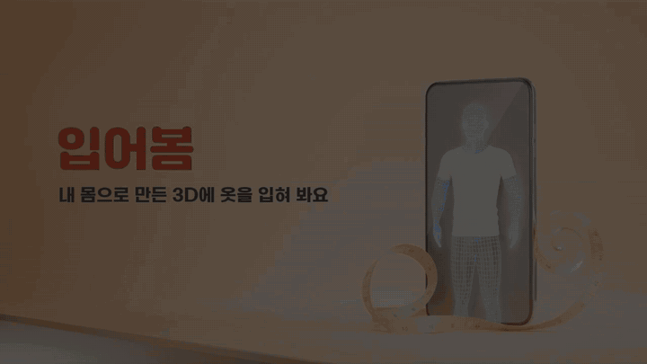
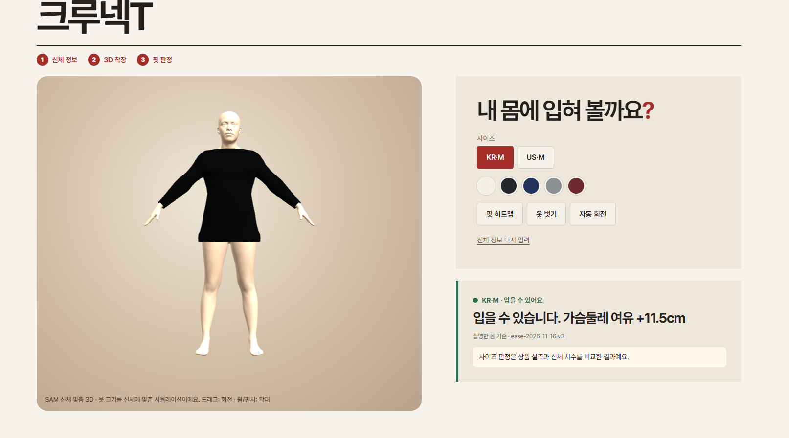
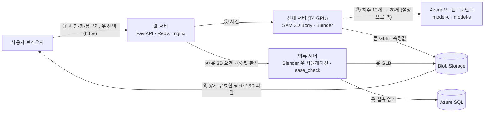

# Fit Me · 사진 한 장으로 먼저 입어 보는 3D 피팅룸

> **English summary** — Fit Me is a virtual fitting service built in two weeks by a six-person team. One full-body photo plus height and weight becomes a 3D body (SAM 3D Body + Blender), a garment is draped on that body with a cloth simulation, and the service tells you whether the chosen size fits. Body measurements for the fit verdict can come from an Azure ML model. Everything runs on Azure (VMs with a T4 GPU, Azure ML, Blob Storage, Azure SQL) with Terraform and GitHub Actions CI/CD.

## 무엇을 하나요

온라인에서 옷을 사면 "내 사이즈인데 안 맞는" 일이 자주 생깁니다. Fit Me는 사기 전에 내 몸으로 먼저 입어 봅니다.

1. 사고 싶은 옷과 사이즈를 고릅니다.
2. 카메라 앞에서 전신 사진을 한 장 찍고 키·몸무게를 입력합니다.
3. 사진에서 **내 몸 그대로의 3D 모델**을 만듭니다.
4. 그 몸에 **옷을 입혀** 3D로 돌려 봅니다.
5. 가슴·허리·엉덩이 둘레와 옷 실측을 비교해 **"입을 수 있어요 / 작아요 / 커요"** 를 알려 줍니다.

| 항목 | 내용 |
|---|---|
| 기간 | 2026.11.04 ~ 11.18 (2주) |
| 팀 | MS AI School 1차 프로젝트 4팀, 6명 |
| 대상 | 매장에서 입어 볼 시간이 없는 성인 남성 (상의 중심 시연) |

## 구조

| 순서 | 하는 일 | 어디서 | 코드 |
|---|---|---|---|
| ① | 사진·키·몸무게 입력, 옷·사이즈 선택 | 웹 (FastAPI + HTML/JS) | [`web/`](web/) |
| ② | 사진 → 3D 몸 복원, 키에 맞춰 크기 보정, 몸 치수 측정 | 신체 GPU 서버 | [`avatar/`](avatar/) |
| ③ | 측정 11개 + 키·몸무게 → 치수 28개 예측 (핏 판정용) | Azure ML 관리형 엔드포인트 | [`ml/`](ml/) |
| ④ | 옷 원본을 그 몸에 맞춰 입히고 시뮬레이션 | 의류 서버 (Blender) | [`garment/`](garment/) |
| ⑤ | 몸 둘레와 옷 실측을 비교해 핏 판정 | 의류 서버 `/fit` | [`ml/ease_check/`](ml/ease_check/) |
| ⑥ | 3D 몸 + 옷을 화면에 표시 | 브라우저 | [`web/static/`](web/static/) |

### ML을 쓰는 방식이 바뀐 과정

- **처음(11/14~11/17)**: 사진에서 잰 치수 11개를 ML이 28개로 늘리고, 그 치수대로 **기본 마네킹을 변형**해 몸을 만들었습니다. 핏 판정도 ML 치수로 했습니다.
- **문제**: 변형한 마네킹에 옷을 입히면 옷이 어색하게 걸리는 경우가 많았습니다.
- **지금**: 3D 몸은 **SAM이 복원한 몸을 그대로** 쓰고, 옷도 그 몸에 맞춰 시뮬레이션합니다. ML은 **핏 판정에 쓰는 둘레 예측**으로 역할을 좁혔고, 신체 서버 설정 `FITME_ML_MEASUREMENTS=on`으로 켭니다(기본 off, 실패하면 SAM 측정값으로 판정). 실제 서버에서 켠 상태로 사이트 끝까지 동작하는 것을 확인했습니다(2026-11-20).

### 파트별로 어디까지 했나

| 파트 | 발표(11/18)까지 만든 것 | 마지막 상태 (이 레포) |
|---|---|---|
| 프론트 | 옷 선택 → 촬영 → 3D 착장 → 핏 판정 화면, 사진 검사, 작업 대기열 | 그대로 동작 |
| 3D 신체 | ① ML 치수로 기본 마네킹을 변형하는 방식(11/14 완성, 사진 1장 17.8초) ② SAM이 복원한 몸을 그대로 쓰는 방식(11/17) | ② 사용. ①의 변형 코드(`avatar/src/geometry/worker.py`, `deform.py`)는 남아 있지만 서비스에서는 부르지 않음 |
| 3D 의류 | 옷 치수표대로 옷을 만드는 방식 → 몸에 맞춰 입히는 옷 시뮬레이션(11/17) | 시뮬레이션 방식. 크루넥T·슬랙스 원본 2종 |
| ML | model-c(13개 → 상체 17개, 평균 오차 1.60cm), model-s(키·몸무게 → 11개), Azure ML 엔드포인트 배포, 빈 값 채우기 | 엔드포인트 코드·학습 SQL 포함. 서비스에서는 핏 판정용 둘레 예측으로 연결(설정으로 켬) |
| 핏 판정 | 상의 가슴둘레 여유분 기준(ease_check), 판정 문구 | 상의만 판정. 하의·상하의 동시 판정은 하지 못함 |
| 데이터 | DB 설계, 브랜드 4곳 옷 실측 수집, Azure SQL 적재 | 3D 원본이 있는 유니클로 상의 중심으로 시연 |
| 인프라 | 네트워크, 웹·의류 자동 배포, GPU 서버, 모니터링·알림, 보안, 비용 관리 | 신체(GPU) 서버는 수동 배포로 남음 |

## 기술 스택

| 분야 | 사용 기술 |
|---|---|
| 웹 | FastAPI, HTML/JS, model-viewer(three.js), Redis, nginx |
| 3D | SAM 3D Body, MoGe, Blender(측정·옷 시뮬레이션), Docker + NVIDIA Container Toolkit |
| ML | Azure Machine Learning(Designer, 관리형 온라인 엔드포인트), 사이즈코리아 데이터 |
| 데이터 | Azure SQL(옷 실측·치수 이름표), Blob Storage(3D 파일·모델 원본) |
| 인프라 | Azure VM·VNet/NSG·Key Vault·Container Registry, Terraform, GitHub Actions(OIDC), Azure Monitor |

## 폴더 안내

| 폴더 | 내용 | 담당 |
|---|---|---|
| [`web/`](web/) | 웹앱(화면 + API + 작업 대기열), 웹 이미지 `Dockerfile` | 프론트 |
| [`avatar/`](avatar/) | 신체 서버: 사진 → 3D 몸(GLB) · 측정값 | 3D |
| [`garment/`](garment/) | 의류 서버: 옷 3D 생성·시뮬레이션, 핏 판정 API | 3D |
| [`ml/`](ml/) | ML 엔드포인트 코드·학습 파이프라인 SQL, [`ease_check/`](ml/ease_check/) 핏 판정 기준 | ML |
| [`infra/`](infra/) | [`terraform/`](infra/terraform/) 네트워크 코드, [`deploy/`](infra/deploy/) 서버 교체 스크립트 | 인프라 |
| [`.github/workflows/`](.github/workflows/) | 자동 배포(웹·의류), Terraform plan/apply | 인프라 |
| [`db/`](db/) · [`opensource/`](opensource/) | DB 테이블·SQL·예시 데이터, 공개 데이터 수집 코드 | 데이터 |
| [`tests/`](tests/) | 신체·의류 서버 회귀 테스트 | 3D |
| [`docs/`](docs/) | [인프라·DevOps 정리](docs/infra/README.md), [3D 서비스 규격](docs/3d/README.md), [초기 PoC 실행 안내](docs/local-poc.md) | |

## 인프라·DevOps 한눈에

자세한 내용은 [docs/infra/README.md](docs/infra/README.md)에 있습니다.

- **네트워크**: 공개·내부·데이터 3구역. 인터넷에 열린 입구는 웹 서버(https) 하나뿐이고, 규칙은 Terraform으로만 바꿉니다.
- **자동 배포**: dev에 머지 → GitHub Actions(OIDC 로그인, 저장된 비밀번호 없음) → 이미지 빌드·레지스트리 저장 → 서버에서 컨테이너만 교체 → health 확인. 되돌리기는 이전 이미지 태그로 바꾸기만 하면 됩니다.
- **보안**: 배포 계정은 필요한 권한만, 서버끼리는 관리 ID, 비밀값은 Key Vault, 중요 리소스는 삭제 잠금 + 변경 알림.
- **속도**: 단계별로 재서 원인을 찾아 신체 3D 생성 **56.2초 → 17.8초**.
- **비용**: GPU는 쓸 때만 켜고 예산 알림·매일 비용 메일로 관리.

## 직접 돌려 보려면

이 레포는 **프로젝트 종료 시점의 코드 기록**입니다. Azure 리소스는 정리했기 때문에 아래가 있어야 실제로 동작합니다.

- 모델 파일은 레포에 없습니다. 신체 모델 4개(`avatar/models/README_MODELS.md`)와 옷 원본(`garment/models/`)은 Blob Storage에서 받도록 되어 있고, SAM·MoGe 가중치는 각 공식 배포처에서 받습니다.
- 주소·IP·리소스 이름은 예시 값이거나 프로젝트 당시 이름입니다. `.env.example` 파일들을 복사해 자기 환경 값으로 채웁니다.
- `.github/workflows/`의 배포는 Azure 로그인 정보(Secrets)가 있어야 동작합니다.
- 서버별 실행 방법: [`avatar/VM_GUIDE.md`](avatar/VM_GUIDE.md), [`garment/VM_GUIDE.md`](garment/VM_GUIDE.md), [`web/README.md`](web/README.md), [`docs/3d/DEPLOYMENT.md`](docs/3d/DEPLOYMENT.md)

## 팀

| 이름 | GitHub | 파트 |
|---|---|---|
| 김예준 | [@kim-ye-jun](https://github.com/kim-ye-jun) | 3D |
| 김평권 | [@Gwone](https://github.com/Gwone) | 데이터 |
| 박미나 | [@itmina04](https://github.com/itmina04) | 데이터, ML |
| 박상호 | [@an2026seong](https://github.com/an2026seong) | 프론트 |
| 손의성 | [@kradipa](https://github.com/kradipa) | 인프라 |
| 유영서 | [@yys0714-max](https://github.com/yys0714-max) | ML |

파트별로 한 일은 아래와 같습니다.

| 역할 | 한 일 |
|---|---|
| 프론트 | 웹 화면, 사진 촬영·검사, 3D 표시, 판정 화면 |
| 3D | 사진 → 3D 몸, 옷 3D·시뮬레이션, 신체·의류 서버 |
| ML | 치수 예측 모델(model-c·model-s), Azure ML 엔드포인트 |
| ML · 핏 판정 | 여유분 기준(ease_check)과 판정 문구 |
| 데이터 | DB 설계, 옷 실측·공개 데이터 수집 |
| 인프라·DevOps | Azure 구조, 네트워크, CI/CD, 배포, 모니터링, 보안, 비용 |

## 외부 코드·모델·데이터

- SAM 3D Body(SAM License), MHR(Apache-2.0), MoGe, Detectron2 등 외부 자산의 출처와 라이선스는 [`avatar/third_party/NOTICE.md`](avatar/third_party/NOTICE.md)에 정리했습니다. 각 라이선스를 따릅니다.
- 웹에 포함한 글꼴·뷰어·OCR 라이브러리는 각 폴더의 LICENSE 파일을 따릅니다.
- 치수 통계는 사이즈코리아 공개 자료를 사용했고, 원본 데이터는 레포에 넣지 않았습니다.
