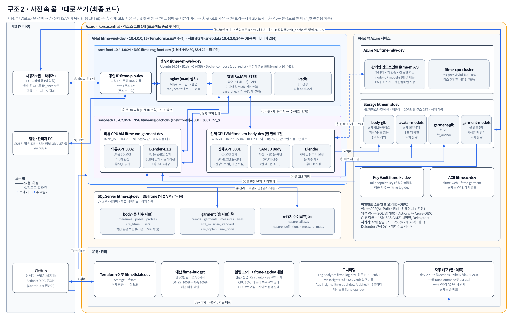
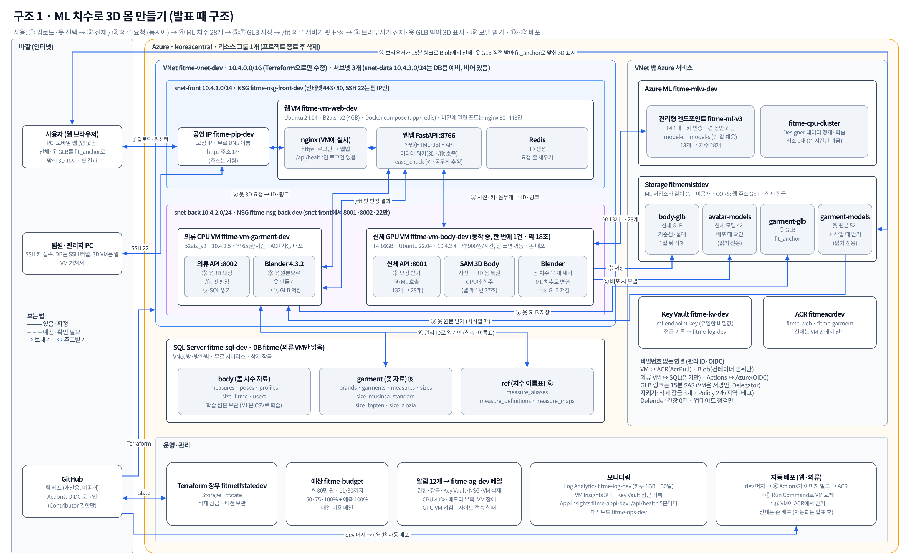

# 인프라 아키텍처 그림

Azure 위에서 서비스가 어떻게 이어지는지 그린 그림입니다. 구조가 한 번 바뀌어서 두 벌이 있습니다.
웹 주소·리소스 그룹 이름·공인 IP는 가렸고, 리소스 이름과 내부 IP(10.4.x.x)는 프로젝트 당시 값입니다. Azure 리소스는 프로젝트 종료 후 정리했습니다.

## 구조 2 · 사진 속 몸 그대로 쓰기 (최종 코드)

이 레포의 코드가 동작하는 방식입니다. SAM이 복원한 몸을 그대로 쓰고, 그 몸에 옷을 시뮬레이션합니다. ML은 설정으로 켤 때만 핏 판정용 치수를 예측합니다(점선).

| 보는 사람 | 그림 |
|---|---|
| 전체 | [structure-2-all.png](structure-2-all.png) |
| 사용자 요청이 지나가는 곳 | [structure-2-user.png](structure-2-user.png) |
| ML 담당 | [structure-2-ml.png](structure-2-ml.png) |
| 3D 담당 | [structure-2-3d.png](structure-2-3d.png) |
| 프론트 담당 | [structure-2-fe.png](structure-2-fe.png) |
| 원본 (draw.io, 5쪽) | [structure-2-sam-body.drawio](structure-2-sam-body.drawio) |

## 구조 1 · ML 치수로 3D 몸 만들기 (발표 때 구조)

발표(11/18) 때 시연한 방식입니다. 사진에서 잰 치수를 ML이 28개로 늘리고, 그 치수대로 기본 마네킹을 변형해 몸을 만들었습니다.

| 보는 사람 | 그림 |
|---|---|
| 전체 | [structure-1-all.png](structure-1-all.png) |
| 사용자 요청이 지나가는 곳 | [structure-1-user.png](structure-1-user.png) |
| ML 담당 | [structure-1-ml.png](structure-1-ml.png) |
| 3D 담당 | [structure-1-3d.png](structure-1-3d.png) |
| 프론트 담당 | [structure-1-fe.png](structure-1-fe.png) |
| 원본 (draw.io, 5쪽) | [structure-1-ml-body.drawio](structure-1-ml-body.drawio) |

## 두 구조의 차이

| | 구조 1 (발표 때) | 구조 2 (최종 코드) |
|---|---|---|
| 3D 몸 | ML 치수 28개로 기본 마네킹을 변형 | SAM이 복원한 몸을 키에 맞춰 그대로 사용 |
| 순서 | 신체와 의류를 동시에 요청 | 신체 먼저 → 핏 판정 → 그 몸에 옷 입히기 |
| 옷 | 옷 원본으로 옷 만들기 | 옷 원본을 신체 3D에 입혀 시뮬레이션 |
| ML | 항상 호출 (몸 만들기 + 핏 판정) | 설정으로 켤 때만, 핏 판정용 치수에만 |

역할별 그림은 전체 그림에서 그 담당이 맡는 곳과 통신만 색으로 강조하고 나머지는 흐리게 한 것입니다.
