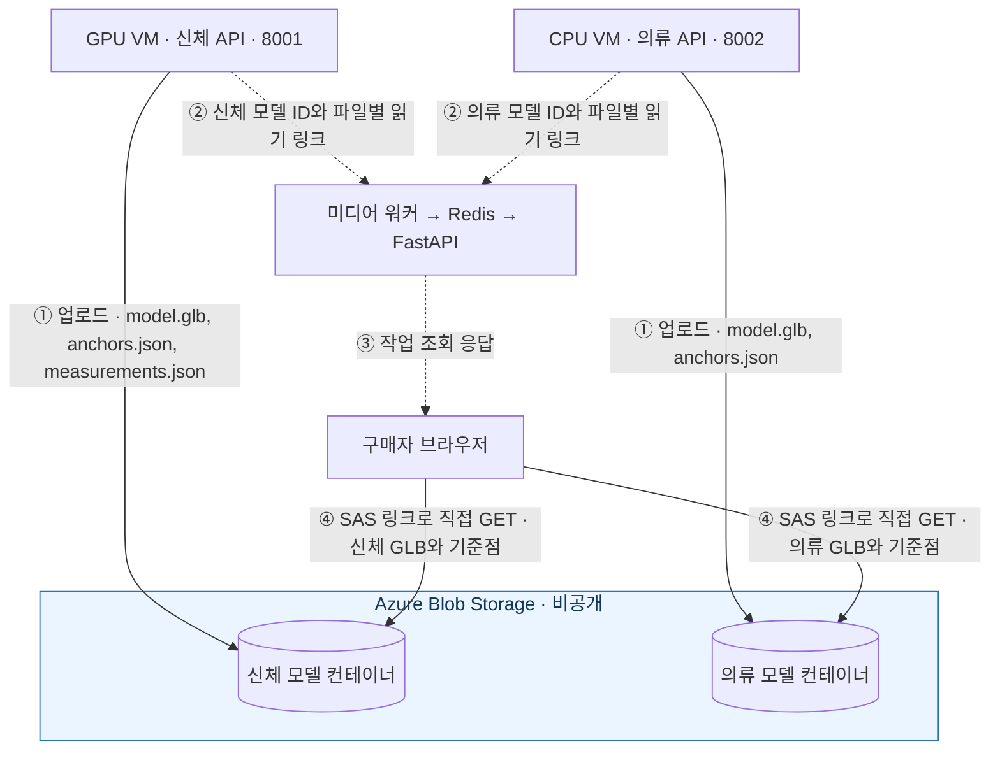
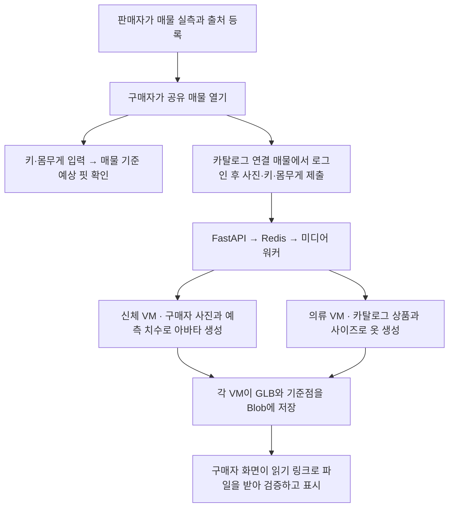
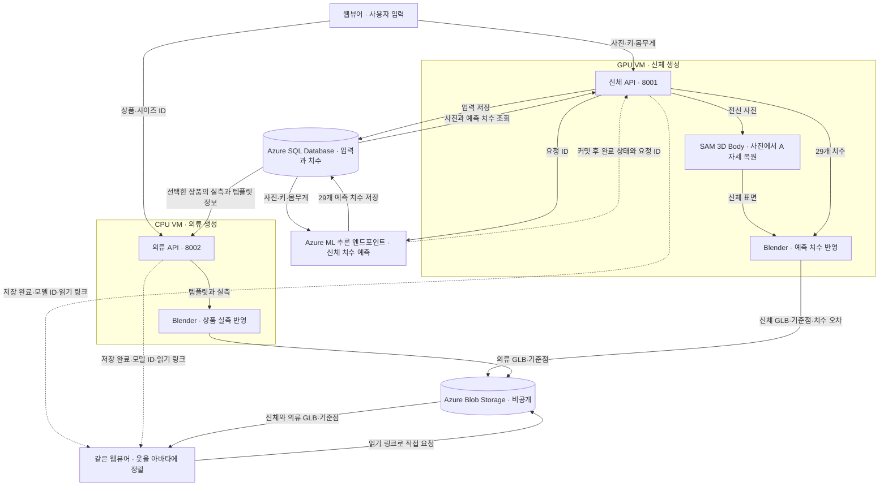

# 입어봄 V2 아키텍처와 프론트 연동 계획

판매자가 공유한 중고 옷의 실측으로 구매자가 예상 핏을 확인한다. 3D 보기는 같은 상품·사이즈가 팀 카탈로그에 연결된 매물에서 제공한다.

## 두 VM과 Azure Blob Storage 연결

각 VM은 자기 컨테이너에 파일 저장을 마치면 모델 ID와 15분간 유효한 읽기 링크(SAS)를 워커에 반환한다. 구매자 브라우저는 링크로 두 컨테이너에서 모델과 기준점을 직접 내려받아 검증하고 옷을 아바타에 정렬한다. 신체의 `measurements.json`은 치수 오차를 확인하는 별도 보고서다.

이 그림은 팀 코드의 연동 규격을 나타낸다. 실제 배포에서는 두 VM의 업로드, 각 컨테이너에서 웹앱 출처의 GET을 허용하는 CORS 설정, 발표 기기에서의 다운로드까지 확인해야 한다.

## 구매자 화면에서 시작하는 두 흐름

핏 비교는 판매자가 올린 매물 실측을 사용한다. 3D 의류는 카탈로그 실측을 사용하므로 수선한 매물과 차이가 날 수 있다.

## 다음 연동 작업

| 담당 | 구현하거나 확인할 내용 | 완료 기준 |
|---|---|---|
| 프론트·핏 판정 | fit_judge 연동 제안. 매물의 사이즈와 원하는 핏을 전달하고 판정 이유를 화면에 표시한다. | 대표 매물의 실측을 전달하는 방식과 신체 추정값 형식을 합의한 뒤 일치·불일치·판단 보류 화면을 확인한다. |
| 프론트·3D | 기존 V2 작업 큐에 배포된 두 VM을 연결하고 구매자 화면에서 실행한다. | 실제 카탈로그 ID로 신체·의류 모델의 기준점 정렬을 확인하고 한쪽만 준비됐을 때의 표시도 확인한다. |

[웹앱 호출 순서와 환경 설정](../web/docs/model-sequence.md) · [3D API 요청·응답 규격](3d/README.md)

## 팀에서 전달한 3D 서비스 내부 구성

아래 그림은 팀 웹뷰어 기준이다. V2에서는 위 그림의 미디어 워커가 VM에 요청한다.

그림의 두 웹뷰어 상자는 같은 브라우저 화면의 입력 단계와 착장 단계입니다. 각 VM은 Blender가 반환한 바이트에서 기준점을 추출해 파일을 업로드합니다. 신체 치수 오차 보고서는 신체 GLB 안에도 들어 있고 별도 measurements.json으로 내려받을 수 있습니다. 현재 웹뷰어는 착장에 필요한 GLB와 anchors.json을 가져옵니다.
