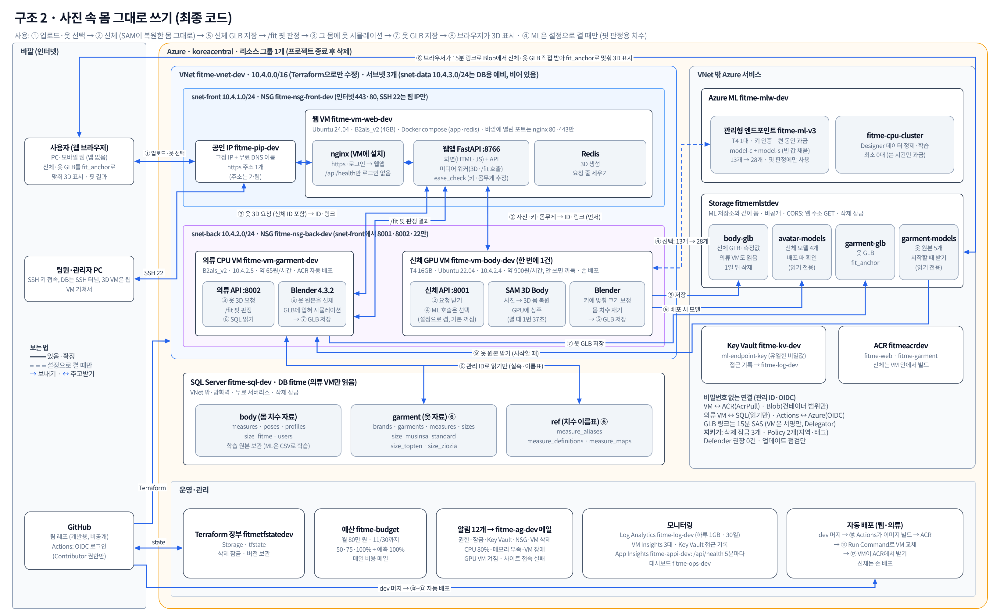
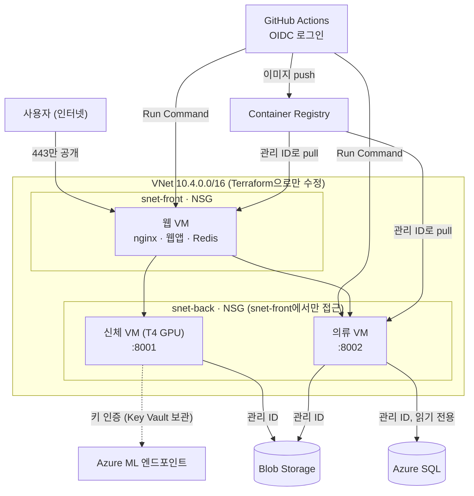

# Fit Me 인프라·DevOps 정리

> 서비스 전체 소개는 [README](../../README.md)를 보세요. 이 문서는 Azure 인프라와 배포 자동화를 어떻게 만들고 운영했는지 정리한 것입니다.
> 주소·IP·계정 이름은 공개 레포에 적지 않았고, 리소스 이름은 프로젝트 당시 이름입니다(리소스는 종료 후 정리).

## 한 줄 소개

사진 1장으로 내 몸을 3D로 만들고, 옷이 맞는지 미리 보여 주는 서비스 **Fit Me**에서 **Azure 인프라와 배포 자동화(DevOps)** 를 맡았습니다.

| 항목 | 내용 |
|---|---|
| 기간 | 2026.11.04 ~ 11.18 (2주, 발표 11/18) |
| 팀 | MS AI School 1차 프로젝트 4팀, 6명 (프론트 · 3D · ML · 인프라) |
| 인프라 담당 범위 | 클라우드 구조 설계, 네트워크·DB, CI/CD, 배포, 모니터링, 보안, 비용 (1명) |
| 결과 | 실제 웹사이트에서 **사진 → 3D 몸 → 옷 착용 → 사이즈 판정**까지 처음부터 끝까지 동작 |

---

## 아키텍처

자세한 그림은 [architecture/infra/](../../architecture/infra/README.md)에 있습니다(구조 1 발표 때 · 구조 2 최종 코드, 전체 + 역할별 4장씩). 손댄 리소스·권한·알림·문제 해결 전체 목록은 [inventory.md](inventory.md)에 있습니다.

아래는 같은 내용을 줄인 그림입니다.

**요청 흐름 (짧게)**
1. 사용자가 웹에서 사진·키·몸무게를 올림 (https)
2. 웹 서버가 내부망으로 **신체 서버(GPU)** 와 **의류 서버**를 호출
3. 신체 서버: SAM 3D Body로 몸을 복원하고 치수를 잼 → 3D 몸(GLB)을 Blob에 저장. 설정을 켜면 **Azure ML 엔드포인트**가 핏 판정용 치수 28개를 예측
4. 의류 서버: Azure SQL에서 옷 실측값을 읽고, 옷 원본을 그 몸에 맞춰 시뮬레이션해 Blob에 저장
5. 브라우저가 Blob에서 3D 파일을 받아 착용 모습과 사이즈 판정을 보여 줌

| 영역 | 구성 |
|---|---|
| 네트워크 | VNet 1개, 서브넷 3개(공개 웹 / 내부 서버 / 데이터), 서브넷마다 NSG. **바깥에 열린 건 웹 서버 443뿐** |
| 서버 | 웹 VM(Docker: 웹앱·Redis·MySQL) + nginx·Let's Encrypt, 신체 VM(T4 GPU), 의류 VM |
| 데이터 | Azure SQL(서버리스, 자동 일시정지), Blob(3D 파일, 1일 자동 삭제 규칙) |
| AI | Azure ML 관리형 온라인 엔드포인트(치수 예측) |
| 배포 | GitHub Actions → Azure Container Registry → VM에서 컨테이너 교체 |
| 운영 | Log Analytics + VM Insights, Application Insights 가용성 테스트, 알림 12개, 운영 대시보드 |

---

## 사용 기술

| 분류 | 기술 |
|---|---|
| 클라우드 | Azure (VM, VNet/NSG, Private DNS, Azure SQL, Blob Storage, Container Registry, Key Vault, Azure ML) |
| IaC | Terraform (원격 state + 삭제 잠금), PR이면 plan / main이면 apply |
| CI/CD | GitHub Actions, **OIDC 로그인**(비밀번호 저장 없음), Run Command 배포 |
| 컨테이너 | Docker, Docker Compose, NVIDIA Container Toolkit (GPU 컨테이너) |
| 웹 | nginx(리버스 프록시·로그인), Let's Encrypt(https) |
| 모니터링·보안 | Azure Monitor 알림, Log Analytics, Application Insights, Azure Policy, Defender 권장 사항, Dependabot |
| 비용 | Cost Management, Budget 알림, 매일 비용 메일 |

---

## 한 일

**1. 클라우드 기반 만들기**
- 리소스 이름·태그 규칙을 정하고 Azure Policy(지역·태그)로 점검 → 준수율 100%
- Terraform으로 VNet·서브넷 3개·NSG 3개·Private DNS 등 **12개 리소스를 코드로 관리**, PR 6개로 단계별 적용

**2. 배포 자동화 (CI/CD)**
- GitHub Actions용 계정을 따로 만들고 **필요한 권한(Contributor)만** 부여, 브랜치별 OIDC 규칙 3개로 비밀번호 없이 로그인
- 프론트: dev 머지 → 이미지 빌드 → 레지스트리 저장(태그 = 커밋) → 웹 VM에서 웹앱 컨테이너만 교체 → health 확인. **첫 배포 약 1분 30초**, DB·캐시는 그대로 유지
- 의류 서버도 같은 방식으로 자동 배포, 문제 생기면 이전 이미지 태그로 되돌리기

**3. GPU 3D 서버 배포**
- SAM 3D Body를 GPU에서 직접 시험해 **T4 1대로 충분**하다는 근거 확보(장당 약 6초, 메모리 최대 약 11GB/16GB)
- GPU VM에 Docker + NVIDIA Container Toolkit 설치, 모델 파일은 VM 디스크에 두고 Blob에서는 필요할 때만 받도록 구성
- 3D·ML 팀 코드를 받아 서버로 띄우고, 웹 → 신체 → ML → Blender → Blob 전체 흐름을 연결
- 마지막에 3D 몸 방식이 바뀌며 빠졌던 ML 호출을, 설정(`FITME_ML_MEASUREMENTS`)으로 켜고 끄는 "핏 판정용 치수 예측"으로 다시 연결

**4. 보안**
- 비밀값은 Key Vault에 모으고, 권한은 사람·서버마다 필요한 범위(컨테이너·Key Vault 단위)로만 부여
- 중요 리소스(Terraform state, DB, 저장소)에 **삭제 잠금**, 권한 추가·삭제·잠금 해제·Key Vault 삭제 시 메일 알림 (테스트로 동작 확인)
- DB는 Entra 그룹 관리자로 팀원 각자 계정 접속, SSH는 허용 IP만

**5. 모니터링·비용**
- VM 상태·삭제 알림, 로그 저장(하루 1GB 한도, 30일), 웹 가용성 테스트, 운영 대시보드
- 예산 알림(50/75/100% + 예측 100%), 매일 아침 비용 메일, 밤 리소스 끄기 점검
- 예산 월 80만 원 중 **11/20까지 약 37.9만 원(약 47%)** 사용. 가장 큰 항목은 GPU VM(약 15만 원)과 Azure ML(약 14만 원)

**6. 문서화·협업**
- 매일 작업 기록, 정기 점검 리스트, 팀원용 DB 접속 안내, 아키텍처 그림(전체 + 역할별 4장)과 서비스 흐름도
- Git 협업 규칙(브랜치 전략) 작성·발표

---

## 문제 → 해결 사례

### 1. 사진 1장 처리 56.2초 → 17.8초 (약 3.2배)
- **문제**: 시연에서 사진 1장에 약 1분이 걸림. 서버를 큰 VM으로 바꿔도 효과가 없었음
- **원인 찾기**: 신체 서버에서 10회 반복 측정 → 평균 56.2초 중 **66%(37초)가 매번 AI 모델을 다시 불러오는 시간**, 실제 처리는 6.5초
- **해결**: 측정 결과를 3D 팀과 공유 → 모델을 서버 켤 때 한 번만 올려 두는 방식(상주)으로 변경 → 배포 후 **17.8초**
- **다음 단계 근거**: 단계별로 다시 재 보니 남은 시간의 2/3가 Blender 2번. Blender 상주로 아낄 수 있는 건 약 3초뿐이라 "하지 않기"로 판단

### 2. 조직 정책으로 막힌 배포 방식 → 서버가 GitHub에 접속하지 않는 구조로
- **문제**: VM에서 코드를 직접 받으려 했지만 조직 정책으로 Deploy key 사용 불가
- **해결**: 빌드는 GitHub Actions에서 하고, 이미지는 레지스트리에 올리고, VM은 **관리 ID로 레지스트리에서만 이미지를 받게** 바꿈 → VM에 GitHub 접속 정보가 아예 없음
- **결과**: 오히려 더 안전해졌고, 커밋 단위로 되돌리기도 쉬워짐

### 3. dev 브랜치가 사라진 사고
- **문제**: dev → main PR을 머지하자 dev 브랜치가 통째로 삭제됨
- **원인**: "머지 후 브랜치 자동 삭제" 설정이 dev에도 적용됨 (무료 private 레포라 브랜치 보호 규칙도 못 씀)
- **해결**: main에서 dev 복구, 자동 삭제 끄기, 작업 브랜치는 머지 후 직접 삭제하도록 규칙 정리·공유

### 4. Portal에서 추가한 방화벽 규칙이 Terraform 적용 때 사라짐
- **문제**: 급할 때 Portal에서 넣은 SSH 허용 규칙이 다음 Terraform 적용에서 지워짐 (코드에 없는 규칙은 지우는 방식)
- **해결**: 허용 IP를 Terraform 변수로 옮기고 "네트워크는 Terraform으로만 고친다" 규칙을 문서화. 급한 경우엔 일부러 "다음 적용 때 자동 삭제되는 임시 규칙"으로만 쓰기로 정함

---

## 배운 점

- **측정이 먼저**: "VM을 키우면 빨라지겠지"는 틀렸고, 단계별 시간을 재고 나서야 진짜 원인(모델 다시 불러오기)이 보였다
- **권한은 작게**: 자동화 계정에 Owner 대신 Contributor만 주니, 역할 할당 같은 위험한 일은 사람이 직접 하게 되어 사고 범위가 줄었다
- **코드로 관리하면 규칙도 같이 필요하다**: Terraform은 코드에 없는 걸 지우기 때문에 "어디서 고치는지"를 팀이 함께 알아야 한다
- **비용은 끄는 습관**: GPU는 시간당 약 900원이라 켜 둔 하루가 가장 큰 비용이었다. 알림·매일 메일·밤 점검으로 예산 안에서 운영

### 아쉬운 점 / 다음에 할 것
- 신체(GPU) 서버는 시간이 부족해 수동 배포 → 의류·프론트처럼 자동 배포로 바꾸기
- 모니터링·알림 등 Portal에서 만든 리소스도 Terraform으로 가져오기(import)
- 신체 서버는 한 번에 1건만 처리 → 여러 사용자용 대기열·확장 구조

---

## 관련 코드

| 무엇 | 어디 |
|---|---|
| 네트워크(VNet·서브넷·NSG·Private DNS) | [`infra/terraform/`](../../infra/terraform/) |
| Terraform plan/apply 파이프라인 | [`.github/workflows/terraform.yml`](../../.github/workflows/terraform.yml) |
| 웹 자동 배포 | [`.github/workflows/front-deploy.yml`](../../.github/workflows/front-deploy.yml), [`web/Dockerfile`](../../web/Dockerfile), [`infra/deploy/web-update.sh`](../../infra/deploy/web-update.sh) |
| 의류 서버 자동 배포 | [`.github/workflows/garment-deploy.yml`](../../.github/workflows/garment-deploy.yml), [`infra/deploy/garment-update.sh`](../../infra/deploy/garment-update.sh) |
| 신체(GPU) 서버 기동·점검 | [`infra/deploy/body-start.sh`](../../infra/deploy/body-start.sh), [`infra/deploy/body-readiness.py`](../../infra/deploy/body-readiness.py) |
