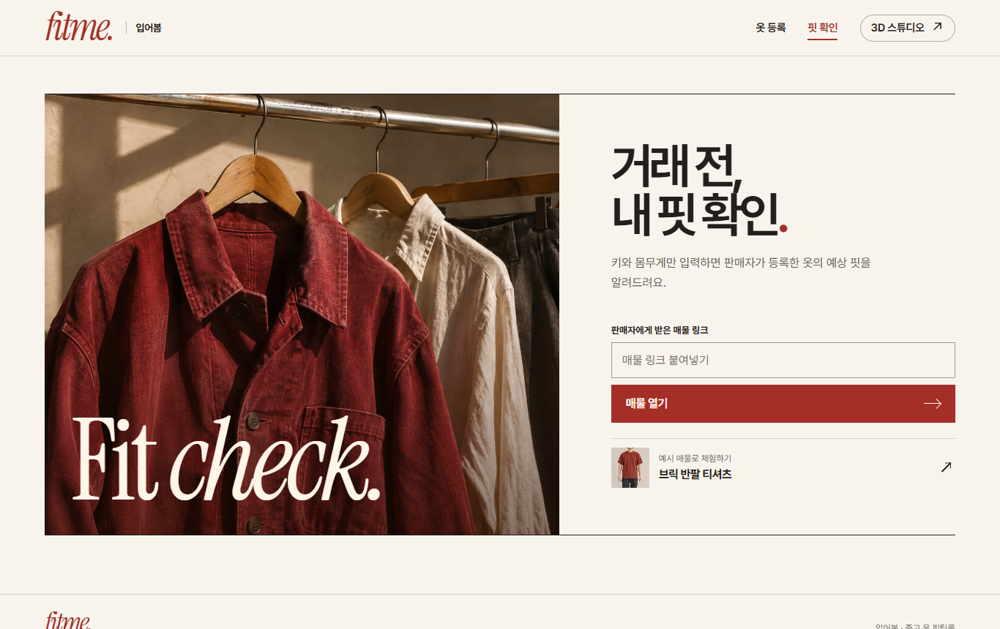

> 이 문서는 프로젝트 초기에 쓰던 **로컬 PC용 PoC 실행 안내**입니다(웹앱 V2 + MySQL 예시 DB). 전체 서비스 소개는 [README](../README.md)를 보세요.
> 로컬 설치 스크립트(`setup.sh`, `windows_setup.cmd`, `windows_app.cmd` 등)와 `실행_가이드.txt`·`명령어_모음.txt`는 공개 레포에 넣지 않았습니다. 아래에서 이 파일들을 가리키는 설명은 당시 기록으로 남겨 둔 것입니다.

# 입어봄 V2 · 중고 옷의 예상 핏

[전체 아키텍처와 프론트 연동 계획](ARCHITECTURE.md)

판매자는 옷 한 벌의 치수와 측정 출처를 담은 매물을 공유한다. 구매자는 그 매물에서 키와 몸무게만 입력해 예상 핏을 확인한다. 체형 차이가 커서 판단하기 어려울 때는 평소 잘 맞는 옷의 단면 하나로 비교할 수 있다.

판매자가 3D팀 카탈로그의 상품·사이즈를 연결하면 로그인한 구매자가 본인 사진으로 신체·의류 모델을 요청할 수 있다. [①~⑨ 모델 생성 흐름도](../web/docs/model-sequence.md) · [3D팀 API 규격](../docs/3d/README.md)

<details>
<summary>V2 화면 미리보기</summary>




[화면별 디자인 적용 근거와 참고 작품 5개](../web/docs/design-references.md)

</details>

팀의 Rocky8와 MySQL이 준비된 Windows PC에서는 이 체크아웃의 `windows_app.cmd`를 실행하고 [V2 홈](http://localhost:8766/)을 연다. Linux에서는 저장소 루트에서 `bash web/run.sh`를 실행한다. V2는 별도 포트와 MySQL 스키마 `fitme_v2`, Redis를 사용한다. 팀 환경 준비, 워커 실행, 실제 의류 측정 서비스와 3D 모델 연결은 [V2 실행 안내](../web/README.md)를 참고한다. 이전 버전(V1)은 개발용 비공개 레포의 `feature/front-test` 브랜치에 있다.

## 3. 코딩 — 옷 사이즈 추천 AI PoC 코드
신체 정보 → AI 로 부위 치수 추정 → 브랜드 옷 치수와 비교 → 사이즈 추천. 공개 데이터를 MySQL(Docker)에 넣고 SQL 로 확인한다.

## 처음 오면 읽는 순서
1. [architecture/README.md](<../architecture/README.md>) — ERD·데이터 흐름 그림
2. [db/README.md](<../db/README.md>) — DB 띄우기
3. [opensource/fetch/README.md](<../opensource/fetch/README.md>) — 공개 데이터 받기

## 첫 실행 (Git Bash, 이 폴더에서 / Python 3.12, fetch 는 추가 설치 없음)
```bash
MSYS_NO_PATHCONV=1 bash db/up.sh                                      # DB 띄우기
cd opensource && python -m fetch.garment.kobo_garment_measurements && cd ..   # 데이터 하나 받기
docker exec -i -e MYSQL_PWD=poc-root poc-mysql mysql -uroot --default-character-set=utf8mb4 < db/query/check/01_table_rows.sql
```
로컬 PC(`windows_setup.cmd` 더블클릭 → WSL Rocky 8)·Linux VM(clone/pull 후 `bash setup.sh`) 모두 같은 `setup.sh` 하나로 `~/poc-size-ai` 에 Docker·DB·예시 데이터·파이썬 예시까지, 환경 차이는 `.env` 값만 — `실행_가이드.txt`(공개 레포에는 없음)

## 더 보기
- [web/README.md](<../web/README.md>) — 입어봄 웹앱: 화면(HTML·JS) + 파이썬 API(FastAPI) + 팀 추천 코드 + Azure(App Service·OpenAI) 연결
- [architecture/README.md](<../architecture/README.md>) · [db/README.md](<../db/README.md>) · [opensource/fetch/README.md](<../opensource/fetch/README.md>) · [db/query/README.md](<../db/query/README.md>) · [db/예시_코드/README.md](<../db/예시_코드/README.md>) — 파트(3D·AI·프론트)별 파이썬 예시
- [CHANGELOG.md](<CHANGELOG.md>) — 버전·Git 사용법 · [requirements.txt](<../requirements.txt>) — DB 예시(PyMySQL)·3D 단계용 패키지(큼) · `산출물_관리대장.xlsx`(공개 레포에는 없음) — 산출물 목록·데이터 소스·용량
