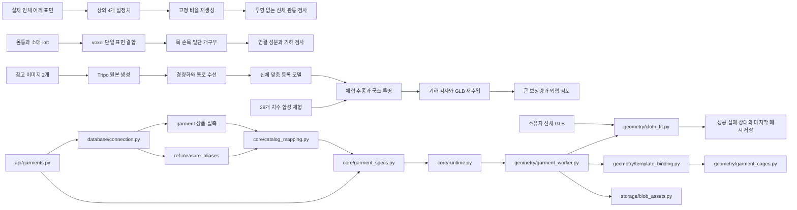

> Current implementation: Blender runs per request and is not resident. Verified original files stay cached on VM disk. SAM residency is unchanged. Current source is authoritative; earlier versioned modeling notes below are historical.

> body_model_id가 있는 현재 피팅은 실제 SAM 단면으로 의류 사본을 맞추며 상품 DB 실측을 크기 입력으로 사용하지 않습니다. 신체 없는 생성은 상의 garment.measures·하의 고정 원형 경로를 유지합니다. 템플릿은 body_center_back_v19와 black_midrise_straight_v1입니다. 현재 SAM 정책은 아래 현재 피팅 절과 ../docs/sam-body-fitting.md를 참조합니다.

# 의류 서비스 아키텍처

v14는 같은 4개 설정값을 유지하고 몸통 허리 구간만 고정 비율 2.5%로 안으로 넣습니다. 어깨·팔은 연결면 평활화 후 가슴너비에 연동된 테이퍼 소매 윤곽으로 정리합니다. 신체를 침범하는 후보 이동은 감쇠하거나 되돌리며, 최종 교차 검사를 통과해야 등록합니다. 새 사용자 치수 입력은 추가하지 않습니다.
팔뚝 이후는 `rebuild_clean_sleeves`가 기존 소매의 단면 고리에 연결된 연속 loft로 재구성합니다. 원형으로 부풀리는 대신 단면 방향별 비율을 유지하며 인체 최소 여유를 계산합니다. 손목 중심은 기존 소매길이 설정을 따릅니다.

`scripts/build_body_proportional_shirt.py`는 인체 상체·팔 표면을 그대로 기준으로 잘라 어깨 경사를 보존합니다. 조절 입력은 상의 4개 실측만 허용하고 목·소매통·밑단·두께는 고정된 비율로 파생합니다. 충돌 부위별 임의 투영은 사용하지 않고 신체 검사를 통과한 결과만 등록합니다. 바지는 불러오지 않습니다. 비례 재생성 전용 정책을 registry에 기록하며 기존 케이지에 다른 치수를 넣는 경로는 차단합니다. 치수 변경은 같은 생성 도구의 `--spec-json`으로 수행합니다.

`scripts/rebuild_smooth_shirt.py`는 몸통과 소매의 폐곡면을 겹쳐 voxel union으로 한 연결 표면을 만들고 목·손목·밑단만 엽니다. 어깨 연결부를 평활화하며 배의 앞뒤 깊이를 급격하게 바꾸지 않고 밑단 설계 너비를 어깨 설계 너비의 약 90%로 제한합니다. 단일 연결 성분·4개 개구부·신체/하의 교차·퇴화 면을 검사한 뒤 등록합니다. 바지는 보존합니다.

## Tripo 이미지 기반 의류와 체형별 검증

`scripts/repair_tripo_shirt.py`는 v10의 손상된 상의 연결면을 새 케이지 기반 메시로 재구성하고 Tripo UV를 참고 자료로 대응시킵니다. 굽혀진 명암 텍스처는 사용하지 않고 무광 검정 재질로 정리합니다. 소매를 손목 방향으로 좁히고 밑단을 바지 밖의 여유 있는 윤곽으로 내려 기준 신체·바지 교차를 검사합니다. 목둘레는 타원형 경계와 부드러운 변위 연결로 정리합니다. 바지 형상은 보존하며 v10 검사 결과를 새 상의에 재사용하지 않습니다.

`prepare_tripo_fit_sources.py`는 Tripo 원본을 별도 보관하고 방향 정규화·경량화 사본을 만듭니다.
새 Tripo 원본에서 내부 막힘이 확인되면 `open_tripo_ports.py`로 통로를 확보한 뒤 모델별 몸통/소매 구분과 손목 기준을 지정합니다. 기본 관통 보정 후 교차가 남는 부분만 세분화하고 재검사합니다. 이 자산별 수선은 임의 의류에 자동 적용할 일반 해법이 아닙니다.
`fit_uploaded_garments.py`로 기본 신체에 맞춰 등록한 뒤 `geometry/body_clearance.py`의 삼각형 대응으로 실제 신체 변형량을 의류에 전달합니다.
`test_tripo_fit_matrix.py`는 서비스의 의류 케이지 변형을 적용하고 신체 추종 → 표면 관통 보정 → 정점·모서리 중점·삼각형 중심과 삼각형 교차·퇴화/비다양체 검사를 실행합니다.
검사에 실패한 케이스는 성공 GLB로 내보내지 않습니다. 보정 전후 최대 이동량을 기록하며 보정 결과는 원래 상품 실측과 달라질 수 있습니다.
닫힌 MHR 신체의 법선 기반 음수 후보는 3방향 광선 홀짝 투표로 재확인해 오목한 사타구니 모서리의 외부 점 오판정을 구분합니다. 기하 검사와 외형 품질 판정은 다릅니다. 단건 출력은 기본 3cm 보정량 검토 기준을 넘으면 차단하며, 이 기준은 천 재질의 물리적 한계가 아닌 운영상 보호 장치입니다.
`project_garment_surface.py`는 의류가 바닥 아래로 연장된 경우 발등 광선 높이 위로 하단을 옮기고, 교차 부위만 세분화해 재투영합니다. 이는 실제 천의 주름/마찰 시뮬레이션이 아니며 원래 바지 길이를 그대로 재현하지 않습니다. 실패 이력은 삭제하지 않고 별도 기록합니다.
`build_fit_test_bodies.py`는 실제 신체 변형기의 29개 치수 각각 ±5%와 전체 ±5% 합성 체형을 생성합니다. 실제 ML 예측 검증이나 모든 치수 조합의 보장은 아닙니다.
상의 4개·하의 7개 실측 각각 ±10%와 복합 변형을 테스트합니다. 신체와 의류 사이의 검사이며 상하의 상호 충돌·천 물리·애니메이션은 포함하지 않습니다.
이 경로는 오프라인 자산 제작/회귀 검증 도구입니다. 기존 API·DB 상품 매핑·Blob·VM에는 자동 반영하지 않습니다.

`scripts/fit_shirt_hem.py`는 v8 비교 장면에서 바지를 제거하고 상의 몸통 밑단을 허리 높이·몸통 허리 단면 너비로 맞춥니다. 원본 좌표로 몸통/소매를 구분하며 가슴 아래에서만 보정량을 연결합니다. 어깨 영역과 앞뒤 좌표는 유지하고 충돌 검사는 하지 않습니다.

`place_original_garments.py --width-only`는 높이·중심 배치에 어깨/허리 주변의 좌우 국소 보정을 더합니다. 소매 하부는 좌우 평행 이동으로 각도와 길이를 유지합니다. 바지 허리 보정은 원본 높이 0.88~0.98m 구간에서 전환하며 다리에는 적용하지 않습니다. 길이·두께 좌표 및 보정 영역 밖의 좌표가 유지됨을 검사합니다. 충돌 계산은 생략합니다.

`scripts/place_original_garments.py`는 원본 GLB의 메시·크기·회전을 유지하고 상의 어깨 중앙과 하의 허리 중앙을 신체 기준점으로 평행 이동합니다. 충돌 검사·보정과 템플릿 재바인딩은 실행하지 않습니다. 위치 비교용 GLB·Blender 장면·검증 보고서를 별도 출력합니다.

`scripts/fit_uploaded_garments.py`는 사용자가 제공한 질감 GLB 상·하의를 새 v6 템플릿으로 변형합니다.
각 의류와 신체 사이의 충돌만 검사·보정하며, 상의와 바지 사이의 충돌 계산과 허리 확장 보정은 수행하지 않습니다.
원본 UV·재질·이미지를 유지하고, 내려간 소매를 신체 어깨→손목 축으로 회전·길이 보정하며 바지는 허리·다리 축에 대응합니다.
닫힌 두께 있는 의류는 경계 수 0이어도 내부 통로가 있을 수 있으므로 목·허리·밑단을 임의로 절단하지 않습니다.
안쪽·바깥쪽 표면의 방향을 이용해 피부 여유 목표를 달리 주고 각 의류와 신체의 교차를 검사합니다.
사용자 제공 모델의 권리는 기존 CC0 자산과 구분하며, source SHA와 생성기 정보를 별도 기록합니다.
검증은 175cm 예시 A 자세에 한정됩니다. 전체 상품 매핑·Blob·VM 배포는 자동 변경하지 않습니다.

`scripts/build_reference_wide_slacks.py`는 참고 이미지의 회색 와이드 팬츠를 v5로 생성합니다.
벨트 고리 5개를 제거하고 장식 없는 허리 밴드·곧은 바지통·프레스선을 재구성합니다.
밑단 축을 기준 신체 다리에 맞춰 재배치하고 흰색 반팔 v4와 신체·의류 교차를 검증합니다.
사진은 스타일 참고이며 새 ID grey_wide_slacks_cc0_v5를 실제 상품 전체에 자동 적용하지 않습니다.

`scripts/build_reference_tshirt.py`는 사용자 참고 이미지의 흰색 크루넥 반팔 스타일을 기존 기준 템플릿에서 만듭니다.
어깨·A 자세는 유지하고 소매 22cm, 몸길이 65cm 기준으로 목밴드·소매 접힘·이중 봉제선·밑단 주름을 모델링합니다.
이미지를 텍스처로 투영하지 않으며 소재는 GLB로 내보낼 수 있는 흰색 무광 PBR 값입니다.
새 ID white_crewneck_cc0_v4는 기존 v3 바지와 함께 기준 착장에 적용하며 전체 상품 category 매핑은 자동 교체하지 않습니다.
사진은 스타일 참고이며 실제 상품 실측 복원이나 모든 신체에 대한 충돌 보장을 의미하지 않습니다.

v3의 `scripts/repair_reference_outfit.py`는 상의 하부 몸통을 분리해 옆구리가 연속되는 튜브와 수평 밑단으로 재구성합니다.
신체·바지 단면을 감싸는 여유 실루엣을 만들고 바지 상부 폭·깊이를 최대 1% 조정합니다.
목·소매·밑단의 정상 입구를 유지하며 신체 교차·상의/하의 교차·비정상 경계·퇴화 면을 검사합니다.
`scripts/check_reference_outfit.py`는 최종 GLB를 다시 배치해 상·하의 삼각형 교차와 표면 표본 간격을 검사합니다.
해당 검사는 지정 기준 신체·기준 사이즈의 정적 착장에 한정되며 다른 체형의 무충돌을 보장하지 않습니다.

`scripts/rebuild_cc0_reference.py`는 제공 ZIP의 모델 데이터만 읽어 지정 신체 GLB 기준 상·하의 v2를 생성합니다.
어깨·소매를 신체 기준점에 맞추고 BVH로 신체와의 삼각형 교차 및 정점·모서리 중점·면 중심의 관통을 검사합니다.
정점 3mm, 표면 표본 1.5mm 여유를 목표로 국소 보정하며 실패 결과는 최종 등록하지 않습니다.
새 registry의 anchor_bindings는 template_binding.py가 케이지 변위와 함께 이동시킵니다.
어깨 기준점 일치와 의류 표면의 여유 간격은 구분하며, 다른 체형·사이즈의 무관통이나 물리적인 핏을 보증하지 않습니다.
`scripts/verify_reference_garments.py`는 실제 garment_worker로 GLB를 생성하고 재수입해 배치·관통을 재검증합니다.
Blender 5.2 원본은 배포용 4.3.2에서 직접 읽히지 않으므로 `scripts/convert_reference_templates.py`가
검증된 GLB를 배포 Blender에서 재수입·저장·재바인딩합니다. 최종 파일은 다시 4.3.2에서 검사해야 합니다.
원본 ZIP·기존 모델 ID·Blob은 수정하지 않으며, v2를 사용하려면 파일 배포와 템플릿 매핑 변경이 별도로 필요합니다.
웹 pair 기본 경로는 신체 생성 → body_model_id 전달 → DB 실측 옷 생성 → Cloth + Collision → GLB 저장입니다.
상품 사이즈 치수를 기준 형태로 유지하며 신체 치수로 옷을 확대하지 않습니다.
runtime은 동시성 슬롯 안에서 storage/body_asset.py로 소유자별 신체 GLB를 읽고 해시를 검증합니다.
geometry/cloth_fit.py는 신체를 앵커 역변환으로 옷 좌표에 맞추고 Collision 대상을 만듭니다.
상의의 초기 배치는 geometry/garment_pose.py에서 목 개구부·어깨·손목을 비교합니다.
목 개구부를 신체 쇄골 선에 강체 등록한 후보와 Blender Armature로 소매/어깨를 회전한 후보를 평가합니다.
전체 확대나 어깨 폭의 신체 치수 맞춤은 하지 않습니다. DB 원형 엣지 늘어남 .5%/수축 2%·면 뒤집힘 검사를 통과하고
관통 표본 수/깊이가 개선되며 최대 깊이가 악화되지 않는 후보만 채택합니다. 실패 후보는 원래 자세로 되돌립니다.
새 SAM GLB의 fit_neck_L/R을 우선 사용하며 이전 GLB는 측정 shoulder_slope_deg의 근사 목 위치를 사용하고 출처를 기록합니다.
initial_pose_before/candidate/selected와 report.initial_pose에 좌우 3D 각도 및 어깨·소매·몸통·밑단 관통 분포를 남깁니다.
garment_geometry 표본 수는 정점+엣지+면 수입니다. inside_samples는 고유 정점 수가 아닙니다.
닫힌 일관된 신체의 면 방향이 전체적으로 안쪽이면 충돌 계산용 면만 반전하고 표시 신체는 유지합니다.
geometry/collision_proxy.py는 옷의 경계 상자를 20cm 확장한 영역과 교차하는 SAM 면을 선택합니다.
선택 영역을 40% 비율로 Decimate하고 양방향 정점·면중심·엣지중점 거리 오차가 2mm 이내이며 면 방향이 유지될 때만 채택합니다.
실패하면 단순화 전 선택 영역을 사용합니다. 표시용 SAM은 변경하지 않으며 최종 관통 판정은 원본 전체 SAM으로 수행합니다.
옷이 선택 영역 밖으로 벗어나면 collision_region_exited 실패로 중단합니다. 절단 경계에는 별도 뚜껑을 만들지 않습니다.
Cloth의 압력·수축·봉제를 끄고 최대 72프레임 계산합니다. 시작 접촉을 검사하고
최대 앞뒤 2cm/위 2cm의 강체 이동 후 제한적인 국소 보정을 시도합니다. 겹침이 남으면 이웃 정점에 보정을 분산하는 relax_contacts를 최대 40회 적용하며 정점 이동은 6cm로 제한합니다. 원래 DB 모서리 길이를 반복 투영하고, 변형률·메시 검사 및 관통 수/깊이가 개선된 후보만 선택합니다.
강체 이동 후 얕은 겹침은 원본 SAM 바깥으로 최대 3회 국소 보정합니다. 깊이 5mm 이하, 총 이동 8mm 이하만 시도합니다.
DB 기준 엣지 늘어남 0.5% 초과/수축 2% 초과 또는 면 뒤집힘이면 보정을 되돌립니다.
Cloth rest_shape_key는 보정 전 DB 형상이며, 시작 위치 보정으로 기준 크기가 바뀌지 않습니다.
유효한 메시의 잔여 신체 겹침은 frame 0 종료 조건으로 사용하지 않습니다. 몸 안쪽 또는 표면 4mm 이내의 고정점을 해제하고, 잔여 겹침이 있으면 첫 12프레임은 중력 없이 충돌 복구를 시도합니다. 13프레임에 중력을 복구하고 안정 프레임을 초기화하며, 복구 경로는 24프레임 이전 settled 종료를 금지합니다. 최종 치수·관통·안정 검사는 그대로 적용하고 실패 시 마지막 메시를 저장합니다. 실제 자기 교차·퇴화 및 합산 초기 변형률 실패는 여전히 실행 전 중단합니다.
초기 자세 조정 전 DB 원형도 보존해 회전 후보로 생긴 국소 변형이 기준 크기에 숨겨지지 않도록 합니다.
지지점은 템플릿 FitMeSupport 그룹을 우선 사용하고, 없으면 실제 경계 루프의 목/허리와 어깨 앵커에서 생성합니다.
새 템플릿 등록 시 지지점 그룹도 함께 저장합니다. 기존 자산도 런타임에서 생성할 수 있습니다.
bounded_preview_v2는 품질 6/충돌 3, 인장 80/압축 20/전단 20, 시간배율 .5, 자기 충돌 거리 1mm이며 실제 소재 물성을 보증하지 않습니다.
질량은 core/cloth_contract.mass_settings에서 전체 옷 질량 / 실제 Cloth 정점 수로 계산합니다.
상의 0.2kg·하의 0.5kg은 실측 물성이 아닌 미리보기 기본값이며
CLOTH_CREWNECK_TOTAL_MASS_KG/CLOTH_SLACKS_TOTAL_MASS_KG로 0.01~5kg 범위에서 지정할 수 있습니다.
잘못된 값은 거절합니다. cloth_simulation.mass와 FITME_STAGE cloth_mass_configuration/cloth_mass_applied에
목표 전체 질량·정점 수·정점당 질량·실제 적용값을 기록합니다. 정점 수가 늘어도 목표 총질량은 유지됩니다.
자기 충돌은 유지하며 DB 원형에서 충돌 두께보다 촘촘한 국소 면만 제외합니다. 신체 Collision은 유지합니다.
연속 5프레임 안정·180초 예산·15% 초과 엣지 늘어남·비유한 좌표에서 조기 종료합니다.
비유한 좌표는 마지막 유효 프레임을 사용합니다. 프레임 시간과 접촉/늘어남을 FITME_STAGE로 기록합니다.
core/cloth_contract.py의 허용 오차를 넘어도 마지막 메시를 수정 없이 확정하고 신체를 제외해 내보냅니다.
늘어남·불안정·관통은 simulation_status=failed와 failure_reasons로 기록합니다.
storage.publish는 실패 영수증(status=error, preview_available=true)에도 GLB·앵커 URL을 반환합니다.
웹은 이 URL을 검증해 실패한 옷을 표시하고 실패 상태·이유를 유지합니다.
시작 및 매 4프레임마다 별도의 완전한 GLB를 원자적으로 교체 저장합니다.
runtime은 최대 4스레드로 실행하고 300초 강제 종료나 프로세스 오류 때 마지막 체크포인트를 복구해 실패 상태로 게시합니다.
한 프레임이 오래 걸리면 180초 예산만으로 중단할 수 없어 300초 강제 종료가 여전히 필요합니다.
core/blender_process.py는 자식 프로세스의 cloth_frame_start/complete 이벤트를 감시합니다.
첫 프레임 60초·이후 30초 초과 시 해당 Blender만 종료하고 frame_timeout으로 체크포인트를 복구합니다.
CLOTH_FIRST_FRAME_TIMEOUT_SECONDS/CLOTH_FRAME_TIMEOUT_SECONDS로 제한을 조절합니다.
중단 프레임·경과·제한시간은 cloth_simulation.interruption에 기록하며 복구 메시의 frames는 저장 프레임입니다.
프레임 사이 준비·단순화·내보내기는 프레임 제한이 아닌 전체 300초 제한을 적용합니다.
유효한 체크포인트 자체가 없는 준비/내보내기 오류는 기존처럼 미리보기 없이 실패합니다.
fitme_garment.fitting_mode=db_cloth_collision이며 cloth_simulation에 검사 결과를 기록합니다.
보고서의 DB 치수는 변형 전 케이지 값입니다. 물성·템플릿별 실제 Blender 검증이 추가로 필요합니다.
의류 VM 관리 ID에 BODY_STORAGE_CONTAINER의 읽기 권한이 필요하며 Blender 제한시간은 300초입니다.
신체 ID 없는 직접 API 요청은 기존 DB 실측 생성 경로를 사용합니다.

웹 FastAPI(8766)의 pair 워커가 사설 주소 10.4.2.5:8002/api/garments를 호출합니다. VM_BIND_IP는 해당 VM 사설 주소로 설정하며 신뢰 웹 프록시의 X-FitMe-Subject를 받습니다. 웹에는 model_id와 GLB·기준점 읽기 링크를 반환합니다. 웹 계약은 web/docs/3d-fastapi.md입니다.

완성된 의류 GLB는 `core/runtime.py` → `storage/blob_assets.publish()`로 전달해
fitmemlstdev의 garment-glb에 모델·앵커를 저장합니다. VM 관리 ID를 사용하고 실제 업로드 시험은 수행하지 않습니다.

SQL API는 의류 VM에서 실행하며 `ActiveDirectoryMsi` 관리 ID 인증을 사용합니다.
ODBC Driver 18은 의류 컨테이너 안에서만 설치합니다. 로컬 Python API 실행과 드라이버 설치는 배포 대상에서 제외합니다.

`item_code`·`size_id`로 garment.garments/sizes/measures를 조회합니다. category의 상의는 body_proportional_shirt_v18,
하의는 black_midrise_straight_v1에 연결하며 ref.measure_aliases의 출처별 sleeve_length 별칭으로 소매 기준을 정합니다.
`sleeve-length-cb`는 center_back, 표준 sleeve-length·소매길이·そで丈는 shoulder입니다.
기준 누락·충돌이나 다른 category는 422로 거절하며 기존 garment_id 요청은 호환합니다. 별도 레시피 테이블은 사용하지 않습니다.
상품·치수 표준 정의는 공통 DB 구조를 재사용하며 서비스 폴더에 초기화 SQL을 복제하지 않습니다.

### v15 shoulder and sleeve refinement
`build_body_proportional_shirt.py` applies a 5.5% local waist inset and a straight sloping shoulder roof. `rebuild_clean_sleeves` uses a convex radial envelope to fill sleeve dents. The four-input contract remains unchanged; body-intersection validation is required before registration.

### v16 upper sleeve only
After continuous sleeve reconstruction, the builder fills proximal upper-sleeve concavities toward the convex x/z silhouette. Correction fades to zero at the arm axis; lower sleeve vertices and waist are unchanged. Final body and topology checks remain required.

### v17 hem side taper
The builder narrows only the lateral bottom edges by up to 2.5%, fading over the lowest 14% of garment length. Front/back depth, upper waist and sleeves remain unchanged. Final body-intersection checks gate registration.

### v18 lower abdomen silhouette
After hem taper, the builder clamps the lower torso lateral silhouette to a straight tapered envelope. Exact body intersection checks still gate export. Sleeves and upper torso remain unchanged.

### Approved shirt Blob release packaging
`scripts/package_shirt_release.py` reads an approved release and its delivered GLB validation, then bundles model/NPZ/registry, four-input JSON, reference body, regeneration code, architecture diagrams and SHA-256 manifest. `docs/shirt-blob-release.md` documents the upload layout and offline regeneration policy. This packaging step does not upload blobs or enable API regeneration.

### Reference black pants preview
`scripts/preview_reference_pants.py` loads the intact v5 scene, hides the shirt, gently tapers lower leg width, applies body clearance and validates intersections before rendering front/side/angle previews and saving a separate scene. The damaged Tripo pants and approved shirt release are unchanged. This is a local style preview, not a deployed template.

### Mid-rise pants preview
`preview_reference_pants.py --mid-rise` lowers the waistband by 3cm, maps its width/depth to the body section at that height with 5mm radial ease, blends over the upper 18cm, then applies body-clearance checks and exports a separate GLB and previews. Original pants and the approved shirt are preserved.

### Mid-rise hip refinement
`preview_reference_pants.py --mid-rise --slim-hips` samples trouser cross-sections and reduces excess lateral hip width with a continuous height-dependent scale, preserving the waistband and lower legs. Body-clearance correction and intersection checks precede preview and GLB export into a separate output directory.

### Straight calf silhouette
`preview_reference_pants.py --mid-rise --slim-hips --straight-calves` adds section-based lateral narrowing from upper leg to hem, removing lower-leg flare while retaining mid-rise and waist settings. It validates body clearance and writes a separate straight-pants scene, GLB and previews.

### Service pants registration and package
`register_reference_pants.py` transforms the approved world-space pants into the actual body waist-anchor frame, then registers black_midrise_straight_v1 BLEND/NPZ/registry. `verify_reference_garments.py` validates baseline worker export against the body. `check_pants_size_controls.py` exercises each of seven cage inputs at +0.5cm and verifies finite changed mesh output. `docs/pants-blob-release.md` documents Blob deployment, remaining category mapping and cage-versus-surface measurement limits.

### Final release consolidation
The canonical approved shirt/pants assets and editable fitting scenes are in `releases/final-garments`. Duplicate upload bundles and intermediate pants previews were removed after hash verification. `check_pants_size_controls.py` now reads the canonical models and writes new smoke outputs to `.cache/pants-size-checks`. Original Tripo sources, v5 pants regeneration input and Blender tooling are retained.

### Approved category mapping
`category_template` maps upper garments to body_proportional_shirt_v18 and lower garments to black_midrise_straight_v1. `generation_settings` retains source-specific sleeve basis. `GARMENT_TEMPLATE_DIR` must reference the downloaded final models directory; old default registries do not contain these IDs. VM configuration and Docker model provisioning remain separate deployment steps.

### Shape-preserving shirt policy v18.1 (current)
`template_binding.deform` validates the registered binding, then calls `shirt_shape.reshape` for four-input region-aware deformation. `protect_reference_body` uses body arrays embedded in the updated NPZ and limits corrections to 8mm; residual penetration, new self-overlap candidates and inverted/collapsed triangles are rejected. Shoulder-based input only, 90..110 percent size range. This supersedes the former regeneration-only shirt policy. `check_shirt_shape.py` covers 21 cases (10 clear generated, 11 safely rejected), and `check_shirt_worker.py` reimports and renders four actual service GLBs. Three inherited neckline overlap candidates remain; different bodies and combined outfit collisions are not covered.

### Current export policy v18.2 (supersedes collision guards above)
User-requested anchor-based export: `template_binding.deform` applies size deformation and writes anchors without body projection, body-reference requirements or collision-based rejection. `shirt_shape.py` no longer contains body correction or self-crossing functions. Numeric/input integrity and collapsed/inverted-face validation remain. Offline checks report collisions diagnostically; 21 of 21 size cases export, including penetrating cases.

### Body girths and fit judgement API
`api.garments` includes `api.fit.router`: POST /fit reads all product sizes using ease_check.MEASURES_SQL, calls sizes_from_db_rows then check_all_sizes unchanged. A catalog query includes sizes without measurements as UNDETERMINED. Module src/ease_check.py comes from origin/feature/ease-check e201b59 and is included by existing Docker COPY src. Existing ingress subject authentication applies. selected contains verdict/message_ko/parts.

### Slacks four-input contract (current)
`garment_specs.validate_spec` requires only waist_width/hip_width/thigh_width/inseam. `api.garments` ignores other DB codes. `complete_slacks_spec` derives rise from registered rise/hip ratio and knee/hem from registered leg-width ratios; `template_binding.deform` uses the NPZ baseline and holds the waist anchor fixed. Worker reports only four supplied metrics plus clearly labeled derived_proportions_cm. `prepare_template.register` keeps the full internal cage baseline in NPZ while publishing four input settings. No body collision correction is added. See docs/slacks-four-inputs.md.

### Live SQL catalog integration (2026-11-16)
Read-only Azure CLI Entra/.NET inspection confirmed 6 demo products/42 size rows only in garment.size_musinsa_standard/size_topten/size_ziozia, absent from normalized product IDs. `database/brand_catalog.py` reads allowlisted tables and maps girths to half-widths. `api.garments` adds brand-catalog discovery and item_code+exact size_label generation fallback; legacy numeric IDs remain unchanged. `api.fit` shares the adapter for all-size fit assessment. Product notes preserve calculated inseam provenance. No top body_length column exists for these products; generation remains a clear missing-field error. All 134 aliases confirm uniqlo_site uses sleeve-length-cb (center-back), requiring separate conversion for the shoulder-only shirt template. See docs/sql-catalog-integration.md. SQL/identity/network resources were not modified.

### Reverted picture-based conversion; verified UNIQLO storage
Picture-derived F-to-G estimation and its module/tests/generated artifacts were canceled. Shirt handling is restored to shoulder-only; raw SQL values and source aliases remain unchanged. Live SELECT joins confirm UNIQLO garment-basis measures for 13 products/116 sizes/457 rows: body_length 116, chest_width 116, garment_shoulder_width 109, sleeve_length 116. Body-basis recommended measurements are distinct. Missing total lengths previously reported concern the three brand-table demo tops, not UNIQLO.

### Current generation policy: normalized tops and static pants
Tops use only garment.measures via the normalized product/size join; no brand-top fallback for selection, generation or /fit. Brand fallback queries explicitly filter category=bottoms, and brand-catalog exposes only the 3 pants products. Slacks worker skips product size validation and uses static_template: unchanged mesh, fixed waist/crotch/hem anchors, empty size report and deformation_applied=false. /fit still uses real garment measurements independently of static geometry. `checks.check_generation` handles the empty static report. Current tests: check_static_slacks.py and test_garment_generation_policy.py; earlier proportional slacks tools/results are historical.

### Blob-pinned native center-back models and resident Blender (current)
Mapping uses body_center_back_v19 plus static black_midrise_straight_v1. Native center-back sleeve parameterization is registered in releases/blob-v19 without changing the source shape or SQL. `api.garments.lifespan` calls `storage.model_cache.ensure_models` once, pins file sizes/SHA-256/ETags, selects an immutable disk cache, then starts `core.garment_resident`. `geometry.resident_worker` preloads 2 BLEND meshes and 2 NPZ bindings; garment_worker copies cached originals per request and preserves them. Registry reads are cached too. Runtime GLB generation uses the resident IPC protocol and existing publication. Docker bundles only the trusted manifest; Compose uses a writable persistent cache. Upload received 403; user selected manual ZIP upload. See docs/blob-resident-models.md.

### Container-root model upload
User uploaded models directly into garment-models. The pinned manifest now uses an empty blob_prefix; model_cache joins root filenames without a leading slash. File hashes are unchanged. Remote listing was denied by the current CLI identity, so actual uploaded contents were not verified.

### Current policy: oneshot Blender, disk model cache only
The API no longer starts or calls resident Blender. Avatar measures SAM surfaces and renders body copies with per-job subprocess.run; SAM inference residency is unchanged. Garment lifespan verifies/downloads model files only, and runtime launches Blender per request. All original cache/Blob paths, center-back shirt and static pants policies stay unchanged. Temporary output descriptors and request copies are cleaned up. Resident helper modules are historical/manual tools, not API paths. See docs/blender-oneshot.md.
## 메시 품질 검사 변경

DB cage 변형 전후에 퇴화·중복 면, 비다양체 모서리, 비인접 면의 자기 교차를 검사합니다. 실패 메시도 `invalid_rest_mesh`로 저장하고 Cloth를 생략합니다. Cloth 직전에는 자세 보정과 밀어내기의 합산 변형률을 원래 DB 메시와 비교합니다.

초기 관통이 없어도 상의 자세 후보를 평가합니다. 관통 수·깊이를 우선하고 소매 각도와 어깨 위치 오차를 비교합니다. 강체 이동은 해부학적 앵커에도 반영하며 정렬 기준 fit_anchor/fit_anchor_waist는 고정합니다.

점 표본 검사에 실제 SAM 전체 표면의 삼각형 교차 검사를 추가합니다. 최종 검사에는 자기 교차·퇴화, 모서리 길이 비율 0.98 이상, 5프레임 연속 1mm 미만 움직임을 요구합니다. 자기 충돌 거리 1mm를 사용하며 기존 watchdog을 유지합니다. 실패 메시도 저장합니다.

교차 검사의 narrow-phase는 후보 100,000개 또는 3초로 제한하며 미완료는 실패입니다. BVH 생성·후보 열거는 이 제한 밖이고 프로세스 watchdog의 보호를 받습니다. 정점을 공유하는 면 쌍은 자기 교차에서 제외하고 단순 접촉·신체와의 공면 접촉은 관통으로 세지 않습니다. 연속 충돌 검출과 모든 인접 면 접힘을 보장하는 검사는 아닙니다.

## 메시 해상도에 맞춘 자기 충돌

`cloth_fit.simulate`는 현재 SAM 크기 조정 후 Cloth 시작 전 기준 형태를 `geometry.cloth_self_collision.configure_self_collision`에 전달합니다. 이 모듈은 polygon을 fan 삼각형으로 나누고 원래 면 ID를 보존합니다. 삼각형 중심 KDTree와 경계 구면·AABB 간격으로 근접 후보를 찾고, 정점을 공유하는 이웃을 제외한 뒤 정점–삼각형·선분–선분 거리와 내부 관통을 검사합니다. BVH의 epsilon에 의존하지 않습니다.

Blender에 실제 적용된 자기 충돌 거리(기본 1mm)의 두 배보다 가까운 면 ID를 순수 정책 함수 `core.cloth_resolution.self_collision_exclusions(..., near_faces=...)`에 전달합니다. 이 함수는 짧은 모서리뿐 아니라 fan 삼각형의 최소 고도(두 배 면적/최장 모서리)가 충돌 거리의 두 배보다 작은 면도 찾습니다. 이 면의 전체 정점과 짧은 모서리 정점을 seed로 잡아 연결 면 한 겹까지 확장하고, 실제 근접 면의 정점도 합쳐 `FitMeDenseSelfContact` 그룹에 넣습니다. 세 정점이 모두 그룹에 속한 삼각형만 자기 충돌 반응에서 제외하며 메시 좌표·토폴로지·SAM 기준 길이는 바꾸지 않습니다. 이후 Cloth 계산으로 새로 발생한 접힘을 제외 조건에 추가하지 않습니다.

후보 검사 최대 100,000쌍 또는 준비 시간 5초를 초과하거나 비유한/퇴화 입력이 있으면 `self_collision_setup_failed`로 안전하게 중단하고 frame 0 메시를 실패 미리보기로 저장합니다. 부분 검사 결과로 자기 충돌을 설정하지 않습니다. KDTree 구축·검색 호출이 끝나면 시간 예산을 확인하며 단일 네이티브 호출 자체의 강제 중단은 전체 프로세스 watchdog이 담당합니다.

신체 Collision과 최종 전체 메시의 자기 교차·관통·치수 검사는 그대로 수행합니다. 제외된 영역의 접힘까지 물리 계산으로 막는 것은 아니므로 최종 검사를 통과해야 성공합니다. `cloth_simulation.self_collision_resolution` 및 같은 이름의 FITME_STAGE 로그에 실제 자기 충돌 거리, 제외 정점·면 수, 최소 고도 seed 면 수(`altitude_seed_faces`), 검사·근접 쌍 수, 준비 시간과 완료 여부·사유를 기록합니다.

## 소매 길이를 보존한 팔 정렬

초기 자세 후보의 소매는 의류 어깨에서 신체 팔 축과 평행하게 회전하는 대신, `core.pose_geometry.sleeve_target_on_arm`으로 실제 팔 구간 위의 소맷단 목표를 구합니다. 어깨 보정 후 의류 어깨를 중심으로 원래 소매 길이의 구면을 만들고 SAM 어깨→손목 선분과의 교점 중 손목 방향 교점을 선택합니다. `garment_pose.articulate`는 기존 소매 벡터를 이 목표 방향으로 회전하며 소매를 늘리거나 줄이지 않습니다. 교점이 없거나 손목·어깨 구간 밖이면 해당 자세 후보만 거절합니다. 최종 후보는 기존 DB 변형률·메시 검사와 접촉 개선 조건을 통과해야 합니다.

## SAM 프로파일의 순수 기하 보조 함수

`core.sam_sizing.bounded_radial_ratio`는 원본 방사 반지름 비율을 `1 + amplitude * tanh((ratio - 1) / amplitude)`로 변환합니다. 기본 amplitude는 0.02이며 SAM 목표 반지름 주위의 작은 원본 윤곽을 양의 비율로 남깁니다. DB 치수는 입력하지 않습니다. 큰 비율 차이는 부동소수점에서 포화될 수 있으므로 이 함수 자체가 최종 면적·자기 교차 품질을 보증하지는 않습니다.

`interpolate_profile(level, levels, samples)`는 엄격하게 증가하는 높이/축 위치와 동일 차원의 중심·반지름 표본을 선형 보간합니다. 범위 밖에서는 끝 표본을 유지하고 단일 표본도 허용합니다. 두 함수는 Blender 없이 동작하며 비유한 값, 음수 반지름 비율과 잘못된 프로파일 차원·순서를 거절합니다.

## 현재 피팅 입력: SAM 신체 기준 크기

`body_model_id`가 있는 생성 요청은 상품·사이즈 존재와 category별 템플릿만 선택합니다. `garment.measures`와 소매 별칭을 조회하지 않으며 상품 치수 검증·케이지 변형 입력을 생략합니다. `garment_worker`는 빈 `spec`과 `geometry_mode=sam_body`로 `template_binding.body_template`을 호출합니다. 이 함수는 원형의 정점·면을 유지하고 등록 해시·바인딩 버전·원형 메시 품질을 검사하며 원래 anchor_bindings.reference를 복원합니다. 상의 shape-preserving 변형도 호출하지 않습니다.

이 원형을 실제 SAM 자산과 함께 `cloth_fit.simulate`에 전달합니다. SAM 기준 크기 조정 기록은 `cloth_simulation.body_sizing`에 별도로 보존하고 GLB의 `fitme_garment_measurements`는 비웁니다. `fitting_mode=sam_body_cloth_collision`로 상품 DB 실측을 반영한 결과와 구분합니다. 원형 품질 실패도 기존 실패 GLB·체크포인트 경로를 사용합니다. 신체 없는 생성은 기존 상의 DB 치수 변형과 하의 고정 원형 경로를 유지합니다.

현재 SAM 경로에서 `geometry.sam_sizing.resize_to_sam`은 SAM 몸통과 팔의 실제 닫힌 단면으로 옷을 조정합니다. 몸통 프로파일은 `core.body_sections.horizontal_contours`로 수평 단면의 연결 성분을 별도 닫힌 윤곽으로 분리한 뒤 `torso_contour`로 신체 중심을 가로지르는 몸통 윤곽 하나를 선택합니다. 기본 선택은 가장 넓은 면적이며 선택적 Y 가이드가 있으면 면적 중심까지의 거리를 우선합니다. 별도 팔·손 윤곽을 함께 감싸는 bounding box는 사용하지 않습니다. 유효 몸통 단면이 없는 높이는 주변 유효 프로파일을 보간하고, 두 다리로 분리되는 아래 구간은 마지막 유효 엉덩이 프로파일을 유지합니다. 모든 높이에서 몸통 단면을 찾지 못하면 실패합니다. 등록 원형의 작은 윤곽은 제한된 방사 비율로 남깁니다.

팔은 `arm_contour`로 어깨→손목 축에 수직인 평면의 닫힌 윤곽 하나를 선택합니다. `core.arm_profiles.ellipse_section`의 다각형 면적 중심으로 축에서 벗어난 중심 offset과 중심 상대 두께를 분리합니다. 원형 소매는 단면 타원 좌표로 정규화하고, SAM 목표 단면은 `offset_radial_profile`로 실제 윤곽의 convex hull 지지 직선을 10mm 평행 이동한 뒤 64각도 방사 반지름을 구합니다. 목표 단면을 둘러싸는 큰 타원으로 대체하지 않습니다. 64각 표본 다각형 둘레와 정확한 지지 직선 offset의 miter 다각형 둘레는 서로 다른 값이며, 이론적 원형 둘레 증가량을 모든 다각형에 그대로 적용하지 않습니다.

원형과 SAM 팔 모두 진행률 0.04~0.98의 32단면을 손목에서 어깨 방향으로 추적합니다. 과대 반경 또는 직전 유효 면적의 0.35~2배를 벗어나는 단면은 제외합니다. 근위 진행률 0.35 미만에서 독립 단면을 잃으면 마지막 유효 팔의 중심 offset·프로파일을 이어 쓰며 유효 단면이 4개 미만이면 실패합니다. 몸통·소매 전환은 원형 어깨 주변 12cm의 smoothstep 가중치로 연결합니다. 소맷단 앵커는 손목 방향 끝점에 목표 단면 중심 offset을 더해 배치합니다.

몸통 프로파일의 여유 20mm와 팔 윤곽 offset 10mm는 별도 입력입니다. 상의의 접촉 보정은 signed clearance 9mm 미만 정점만 `FitMeSizingContact` 그룹으로 선택해 native Shrinkwrap `NEAREST_SURFACEPOINT` + `OUTSIDE_SURFACE`, offset 10mm를 적용합니다. 이미 9mm 이상 떨어진 점과 몸통의 기존 여유는 유지합니다. 국소 Smooth·Decimate 뒤에도 같은 상의 정책을 사용합니다. 하의는 기존 trigger 16mm → offset 20mm 정책을 유지합니다. 전체 옷의 균일 최소 간격 보장을 의미하지 않습니다. 임시 그룹·modifier·신체 계산 객체를 정리하며 원본 SAM GLB·정점·앵커는 변형하지 않습니다.

`body_sizing.sleeves.L/R.method=isolated_arm_offset_contour`와 `body_profile`·`source_profile`에 선택 단면 수, 제외 수, 유효 진행률 범위, 면적 중심 방식과 원래 윤곽 둘레 범위를 기록합니다. `sections`는 진행률별 중심 offset·enclosing 반경·`target_profile_girth_cm`를 포함합니다. enclosing 반경은 진단용이며 실제 목표는 64각도 프로파일입니다. `target_profile_girth_cm`는 목표 표본 다각형의 둘레이고 최종 GLB 소매 단면의 직접 실측값은 별도 검증으로 구합니다.

방사 표의 방향별 반지름은 `sample_radial_profiles`의 주기 선형 보간으로 조회합니다. 크기 조정·메시 정리 후에는 `_validate_sleeves`가 진행률 0.4/0.55/0.75/0.9에서 실제 의류 단면을 다시 잘라 목표 중심·둘레와 비교합니다. 이 Cloth 전 검사에서 중심 차이가 10mm를 넘거나 목표 둘레보다 20mm 넘게 크거나 30mm 넘게 작으면 크기 맞춤 실패로 저장합니다. 결과는 `body_sizing.sleeve_fit_validation`에 실제 둘레·목표 둘레·중심 차이로 기록합니다. 이 검사는 SAM 크기 맞춤이 뒤틀리는 것을 막는 검사이며 이후 Cloth rest 대비 0.5% 늘어남 검사와 별개입니다. 원형/목표 수식만 일치하거나 신체 관통이 0인 것으로 소매 크기를 통과시키지 않습니다.

SAM 크기를 적용한 의류에 2,500개가 넘는 면이 있으면 `_condition_cloth_mesh`가 native Decimate ratio 0.2와 triangulation으로 미세 삼각형을 정리합니다. UV·재질을 포함한 데이터 레이어 보존 옵션으로 결과 메시를 만들고, 정리 전후 양방향 정점→표면 거리의 표본 최대값이 6mm를 넘으면 채택하지 않고 `sam_sizing_failed`로 저장합니다. 이 오차는 Decimate 자체의 정점 표본 검사이며 전체 표면의 수학적 최대 오차 보장은 아닙니다. 채택 후에는 지지점 그룹을 다시 만들 수 있도록 기존 FitMeSupport를 제거하고, 선택적 outside 보정·국소 접힘 완화를 다시 수행합니다. 원본 템플릿 파일과 표시용 SAM 신체는 유지하며 메시 정리는 의류 사본의 정점·면에만 적용합니다. 적용 여부·입출력 수·표본 오차는 `body_sizing.cloth_conditioning`에 기록합니다.

크기 조정·메시 정리·최종 outside/접힘 보정이 끝난 의류를 새 spring rest인 `sam_sized_template`으로 확정합니다. 이전 DB 원형의 길이는 이 단계의 변형 한계가 아닙니다. 이후 중력을 0으로 설정한 Cloth + Collision 안정화를 최대 36프레임 수행합니다. Cloth quality는 8, tension/compression/shear stiffness는 각각 500이며, 12프레임부터 연속 5프레임의 움직임이 1mm 미만이면 조기 종료할 수 있습니다. 최종 늘어남 0.5%·수축 2%와 면 변형 검사는 새 SAM rest 대비이며 원본 전체 SAM 표면의 관통·전체 옷의 자기 교차·안정 검사도 유지합니다. SAM 크기 조정 실패는 `sam_sizing_failed`로 해당 시점 메시를 저장합니다. 이 절의 정책을 현재 body_model_id 경로에 적용하며 앞선 DB spring·중력 낙하 설명은 이전 피팅 경로의 기록입니다.

`core.cloth_checkpoint.interrupted_preview`는 새 SAM 모드와 기존 DB 모드 모두 복구합니다. 전체·프레임 제한시간 초과와 프로세스 중단 시 마지막 완전한 GLB의 binary와 body_sizing을 유지하고 실패 사유만 추가해 게시합니다.

## SQL 연결 준비 재시도

Azure SQL의 일시적인 연결 중단에 대응해 `database.connection._connect`는 처음 로그인 제한시간 10초를 유지합니다. 연결 단계에서만 SQLSTATE HYT00/HYT01/08S01 또는 native 오류 40613/40197/40501이 발생하면 2초 후 로그인 제한시간 45초로 한 번 더 연결합니다. 그 밖의 오류에는 기다림·재시도를 추가하지 않습니다. 연결 문자열이나 ODBC 오류 원문은 로그에 출력하지 않습니다.

재시도 블록은 `transaction`의 cursor 생성·쿼리 실행·commit 이전에만 있습니다. 이미 시작한 쿼리나 commit이 실패하면 기존 rollback/close 경로를 수행하며 트랜잭션을 다시 실행하지 않습니다. 두 번째 연결도 실패하면 세부 내용을 포함하지 않는 `DatabaseUnavailable`을 발생시킵니다. `api.garments`는 이 예외와 `pyodbc.OperationalError`를 HTTP 503, Retry-After 5초의 일반 안내로 반환합니다. 이 처리기는 같은 앱의 `/fit`에도 적용합니다. HTTP 응답을 받은 클라이언트가 자동으로 트랜잭션을 재생하는 정책은 추가하지 않습니다.
