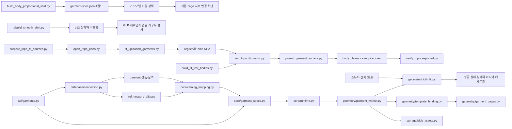

> Current implementation: Blender runs per request and is not resident. Verified original files stay cached on VM disk. SAM residency is unchanged. Current source is authoritative; earlier versioned modeling notes below are historical.

> body_model_id가 있는 현재 피팅은 실제 SAM 단면으로 의류 사본을 맞추며 상품 DB 실측을 크기 입력으로 사용하지 않습니다. 신체 없는 생성은 상의 garment.measures·하의 고정 원형 경로를 유지합니다. 템플릿은 body_center_back_v19와 black_midrise_straight_v1입니다. 현재 SAM 정책은 아래 현재 피팅 절과 ../docs/sam-body-fitting.md를 참조합니다.

# 의류 서비스 파일 연결

4입력 비례 생성 → `refine_style` → 몸통 한정 허리 안쪽 보정·어깨 평활화·테이퍼 소매 → 후보 이동 충돌 시 되돌리기 → v14 검사·등록. 목·소매 끝·밑단 경계는 평활화에서 고정합니다.
이후 `rebuild_clean_sleeves`가 연결 고리를 보존해 팔뚝~손목 소매를 재구성하고, 최종 신체 교차·단일 연결·4개 개구부를 재검사합니다.

인체 GLB·실제 치수 → `build_body_proportional_shirt.py` + 선택적 4필드 spec JSON → 인체 어깨 기준 비례 생성 → 신체/연결 검사 → v13 상의·garment-spec.json·proportional-report.json. `template_binding.deform`은 v13의 기준 치수 내보내기만 허용하며 다른 치수는 생성 도구 재실행을 요구합니다.

기준 신체 앵커 + 기존 하의 → `rebuild_smooth_shirt.py` → 몸통/소매 solid loft → voxel union → 연결부 평활화 → 4개 개구부 절단 → 관통/연결 검사 → v12 상의·기준 장면·repair-report.json.

v10 등록 모델 + 기준 신체 → `repair_tripo_shirt.py` → 연결 메시 재구성·참고 UV 대응·무광 재질 → v11 상의 모델·기준 장면·repair-report.json. 하의는 동일 형상으로 복사 등록합니다. 새 상의의 대표 13개 변형과 최종 전달 GLB의 신체/상하의 교차를 별도 검사합니다.

Tripo CLI 이미지 생성 → 원본 GLB 보관 → `prepare_tripo_fit_sources.py` → 작업용 GLB → `fit_uploaded_garments.py` → 등록 모델·케이지 바인딩.
기본 신체 blend → `build_fit_test_bodies.py` → 체형 NPZ·앵커·입력/실제/적용 치수 → `test_tripo_fit_matrix.py`.
등록 모델 + 케이지 spec → `template_binding.deform` → `body_clearance.follow_body` → `clear_body` → `require_clear` → 통과한 GLB·matrix-results.json.
단건 경로: 실제 신체 NPZ + 의류 spec JSON + 등록 모델·신체 대응 바인딩 → `fit_body_garment.py` → 통과 시 model.glb, 실패 시 진단만 기록. `verify_tripo_exported.py`가 내보낸 결과를 재수입해 검사합니다.

v8 Blender 장면 + 원본 상의 정점 대응 → `fit_shirt_hem.py` → 바지 제거·몸통 하단 높이/너비 보정 → 상의 GLB·장면·hem-report.json.

`place_original_garments.py --width-only`: 신체 어깨 앵커 간격·허리 수평 단면 너비 → 원본 어깨/허리 기준 너비와 비교 → 해당 부위 X 좌표 국소 보정 → 높이 배치 → GLB·장면·너비 보고서. 기존 전신 변형·충돌 경로는 사용하지 않습니다.

원본 의류 GLB + 신체 어깨/허리 앵커 → `scripts/place_original_garments.py` → 평행 이동만 적용 → shirt.glb·pants.glb·착장 장면·placement-report.json. 이 경로는 기존 의류 변형·충돌 함수들을 호출하지 않습니다.

첨부 GLB 2개 + 기준 신체 → fit_uploaded_garments.py → UV 보존·A 자세·허리/다리 축 변형 → v6 모델·바인딩·검사 보고서.
검사 보고서는 신체 충돌만 포함합니다. 상하의 상호 충돌 검사는 호출하지 않으며, 서로의 형상을 바꾸지 않습니다.

바지 참고 이미지 + 기존 착장 → build_reference_wide_slacks.py → 벨트 고리 제거·회색 와이드 v5 → GLB·상/하의 충돌 검증.

참고 이미지의 시각적 특징 + v3 기준 템플릿 → build_reference_tshirt.py → 흰색 반팔 v4 모델·기준 착장·스타일 검사 보고서.

v2 의류 + 기준 신체 → repair_reference_outfit.py → 옆구리·밑단 재구성 + 바지 상부 조정 → v3 모델·outfit-report.json.
v3 실제 GLB + 기준 신체 앵커 → check_reference_outfit.py → 상/하의 교차·표본 간격 검사 → outfit-validation.json.

제공 ZIP 모델 데이터 + 기준 신체 GLB → scripts/rebuild_cc0_reference.py → v2 blend·npz·registry·충돌 보고서.
registry.anchor_bindings → geometry/template_binding.py → 실제 어깨·소매 기준점의 케이지 변위 추적.
scripts/verify_reference_garments.py → geometry/garment_worker.py → 실제 GLB 재수입 → 기준 신체 관통 재검사.
검증 GLB → scripts/convert_reference_templates.py(배포 Blender) → 호환 blend·npz → 최종 GLB 재검증.
web/model_pair.py → 신체 VM → 검증된 body_model_id → 의류 API → DB 상품 실측/소매 기준 → runtime.
runtime → storage/body_asset.py → 같은 계정의 body-glb 소유자별 경로 → 해시 검증 → Blender 입력 전용 body_glb_b64.
garment_worker.py → template_binding.deform(DB spec) → cloth_fit.simulate(신체 Collision, 옷 Cloth) → core/cloth_contract.py 판정 → 성공·실패 모두 마지막 메시 GLB.
garment_worker.py의 simulation_status/failure_reasons → storage.publish의 실패 영수증 및 모델 URL →
web/model_pair.ready_model의 실패 미리보기 URL 검증 → fit-room.js의 실패 옷 표시 및 error 단계.
body_glb_b64는 GLB extras에서 제거하며 신체 메시도 의류 결과에 포함하지 않습니다.
fit-room.js는 db_cloth_collision 결과의 착장 시뮬레이션 안내를 표시합니다.
pair-files.js는 GLB와 앵커의 종류·fitting_mode·body_model_id를 대조하고 하의 앵커를 검증합니다.
tryon-glb.js는 상의 fit_anchor, 하의 fit_anchor_waist를 서로 정렬합니다.
tryon-glb.js는 시뮬레이션 신체 ID가 표시할 신체와 다르면 착장을 거절합니다.
web/v2_worker.py의 pair lease는 두 VM 순차 요청 시간 합계에 여유를 더해 중복 실행을 방지합니다.

prepare_template.register → cloth_fit.support_group → 템플릿 FitMeSupport 저장.
cloth_fit.simulate → garment_worker.checkpoint → 임시 GLB 원자적 교체 저장.
runtime은 FITME_CHECKPOINT 경로를 주입하고 FITME_STAGE 로그를 실시간 중계합니다.
runtime의 300초 시간 초과/프로세스 오류 → core/cloth_checkpoint.interrupted_preview → 실패 GLB 게시.
체크포인트의 바이너리 메시를 그대로 유지하고 중단 원인만 추가합니다. 작업 종료 후 임시 파일은 삭제합니다.

cloth_fit.simulate → collision_proxy.build_proxy → core/cloth_geometry.select_region → 계산용 Decimate/오차검사.
core/cloth_geometry.push_out → 원본 전체 SAM 접촉 조회 → DB 엣지·면 검사 → rest_shape_key에 보정 전 DB 형상 지정.
garment_worker.checkpoint는 Shape Key를 제거한 별도 사본을 저장하며 실제 시뮬레이션의 기준 키는 보존합니다.
runtime → core/blender_process.run_blender → core/frame_watch.FrameWatch → 프레임 초과 시 kill/회수 →
cloth_checkpoint.interrupted_preview(frame_timeout, interruption) → 기존 실패 GLB 게시 및 웹 표시.
scripts/check_cloth_preprocess.py는 합성 신체로 실제 Blender에서 영역 선택·표시 원본 보존·Rest Shape Key·독립 사본을 검사합니다.

SAM GLB 목·어깨·손목 노드/측정 어깨경사 → cloth_fit.simulate → garment_pose.candidates → core/pose_geometry.pose_strain.
목 등록/Armature 후보별 관통 및 DB 엣지/면 검사 → 개선 후보만 채택 → 원래 DB Rest Shape 유지 → Cloth.
garment_worker.sync_anchors는 채택된 옷 자세의 어깨·소매 앵커를 중간 및 최종 GLB에 동기화합니다.
core/pose_geometry.orient_closed_surface → 충돌 면 방향 진단/필요 시 반전 → 원본 SAM BVH 및 계산 프록시.
cloth_fit.simulate → core/cloth_contract.mass_settings(kind, 정점 수, 환경변수) → ClothSettings.mass에 정점당 kg 적용.
설정 및 실제 적용 질량은 FITME_STAGE와 cloth_simulation.mass에 기록합니다. DB 치수·옷 크기는 변경하지 않습니다.
검사 스크립트는 초기 피팅 후보의 토폴로지 유지와 임시 Armature 정리도 검사합니다.

웹 web/model_pair.py → 의류 FastAPI POST /api/garments: 선택한 상품·사이즈 JSON과 X-FitMe-Subject 헤더. 의류 API → 웹 pair 워커: 완성 모델 ID와 GLB·기준점 파일별 읽기 링크 JSON.

완료 결과: `geometry/garment_worker.py` → GLB 메모리 파일 → `core/runtime.py` → `storage/blob_assets.publish()`
→ `garment-glb/v2/garments/<GLB 해시>/` → 모델·앵커 URL 응답.

SQL 인증: 의류 VM의 컨테이너 → ODBC Driver 18 → ActiveDirectoryMsi 관리 ID → Azure SQL.
로컬 전용 SQL 인증·진단 경로는 제거했습니다. 토큰·SQL 비밀번호를 출력하지 않습니다.

item_code·size_id → garment 상품·실측 → core/catalog_mapping.py의 category 매핑 →
ref.measure_aliases의 출처별 소매 기준 → 입력 검증 → 로컬 registry 템플릿. 별도 레시피 DB 조회는 없습니다.
상품·치수 표준 정의는 공통 DB 구조를 재사용하며 서비스 폴더에 초기화 SQL을 복제하지 않습니다.

Blender 스크립트는 src/를 Python 경로에 추가합니다. API 실행 위치는 컨테이너 /app/src입니다.

### v15 shoulder and sleeve refinement
`build_body_proportional_shirt.py` applies a 5.5% local waist inset and a straight sloping shoulder roof. `rebuild_clean_sleeves` uses a convex radial envelope to fill sleeve dents. The four-input contract remains unchanged; body-intersection validation is required before registration.

### v16 upper sleeve only
After continuous sleeve reconstruction, the builder fills proximal upper-sleeve concavities toward the convex x/z silhouette. Correction fades to zero at the arm axis; lower sleeve vertices and waist are unchanged. Final body and topology checks remain required.

### v17 hem side taper
The builder narrows only the lateral bottom edges by up to 2.5%, fading over the lowest 14% of garment length. Front/back depth, upper waist and sleeves remain unchanged. Final body-intersection checks gate registration.

### v18 lower abdomen silhouette
After hem taper, the builder clamps the lower torso lateral silhouette to a straight tapered envelope. Exact body intersection checks still gate export. Sleeves and upper torso remain unchanged.

### Approved shirt Blob release packaging
`scripts/package_shirt_release.py` reads an approved release and its delivered GLB validation, then bundles model/NPZ/registry, four-input JSON, reference body, regeneration code, architecture diagrams and SHA-256 manifest. `docs/shirt-blob-release.md` documents the upload layout and offline regeneration policy. This packaging step does not upload blobs or enable API regeneration.

### Reference black pants preview
`scripts/preview_reference_pants.py` loads the intact v5 scene, hides the shirt, gently tapers lower leg width, applies body clearance and validates intersections before rendering front/side/angle previews and saving a separate scene. The damaged Tripo pants and approved shirt release are unchanged. This is a local style preview, not a deployed template.

### Mid-rise pants preview
`preview_reference_pants.py --mid-rise` lowers the waistband by 3cm, maps its width/depth to the body section at that height with 5mm radial ease, blends over the upper 18cm, then applies body-clearance checks and exports a separate GLB and previews. Original pants and the approved shirt are preserved.

### Mid-rise hip refinement
`preview_reference_pants.py --mid-rise --slim-hips` samples trouser cross-sections and reduces excess lateral hip width with a continuous height-dependent scale, preserving the waistband and lower legs. Body-clearance correction and intersection checks precede preview and GLB export into a separate output directory.

### Straight calf silhouette
`preview_reference_pants.py --mid-rise --slim-hips --straight-calves` adds section-based lateral narrowing from upper leg to hem, removing lower-leg flare while retaining mid-rise and waist settings. It validates body clearance and writes a separate straight-pants scene, GLB and previews.

### Service pants registration and package
`register_reference_pants.py` transforms the approved world-space pants into the actual body waist-anchor frame, then registers black_midrise_straight_v1 BLEND/NPZ/registry. `verify_reference_garments.py` validates baseline worker export against the body. `check_pants_size_controls.py` exercises each of seven cage inputs at +0.5cm and verifies finite changed mesh output. `docs/pants-blob-release.md` documents Blob deployment, remaining category mapping and cage-versus-surface measurement limits.

### Final release consolidation
The canonical approved shirt/pants assets and editable fitting scenes are in `releases/final-garments`. Duplicate upload bundles and intermediate pants previews were removed after hash verification. `check_pants_size_controls.py` now reads the canonical models and writes new smoke outputs to `.cache/pants-size-checks`. Original Tripo sources, v5 pants regeneration input and Blender tooling are retained.

### Approved category mapping
`category_template` maps upper garments to body_proportional_shirt_v18 and lower garments to black_midrise_straight_v1. `generation_settings` retains source-specific sleeve basis. `GARMENT_TEMPLATE_DIR` must reference the downloaded final models directory; old default registries do not contain these IDs. VM configuration and Docker model provisioning remain separate deployment steps.

### Shape-preserving shirt policy v18.1 (current)
`template_binding.deform` validates the registered binding, then calls `shirt_shape.reshape` for four-input region-aware deformation. `protect_reference_body` uses body arrays embedded in the updated NPZ and limits corrections to 8mm; residual penetration, new self-overlap candidates and inverted/collapsed triangles are rejected. Shoulder-based input only, 90..110 percent size range. This supersedes the former regeneration-only shirt policy. `check_shirt_shape.py` covers 21 cases (10 clear generated, 11 safely rejected), and `check_shirt_worker.py` reimports and renders four actual service GLBs. Three inherited neckline overlap candidates remain; different bodies and combined outfit collisions are not covered.

### Current export policy v18.2 (supersedes collision guards above)
User-requested anchor-based export: `template_binding.deform` applies size deformation and writes anchors without body projection, body-reference requirements or collision-based rejection. `shirt_shape.py` no longer contains body correction or self-crossing functions. Numeric/input integrity and collapsed/inverted-face validation remain. Offline checks report collisions diagnostically; 21 of 21 size cases export, including penetrating cases.

### Body girths and fit judgement API
`api.garments` includes `api.fit.router`: POST /fit reads all product sizes using ease_check.MEASURES_SQL, calls sizes_from_db_rows then check_all_sizes unchanged. A catalog query includes sizes without measurements as UNDETERMINED. Module src/ease_check.py comes from origin/feature/ease-check e201b59 and is included by existing Docker COPY src. Existing ingress subject authentication applies. selected contains verdict/message_ko/parts.

### Slacks four-input contract (current)
`garment_specs.validate_spec` requires only waist_width/hip_width/thigh_width/inseam. `api.garments` ignores other DB codes. `complete_slacks_spec` derives rise from registered rise/hip ratio and knee/hem from registered leg-width ratios; `template_binding.deform` uses the NPZ baseline and holds the waist anchor fixed. Worker reports only four supplied metrics plus clearly labeled derived_proportions_cm. `prepare_template.register` keeps the full internal cage baseline in NPZ while publishing four input settings. No body collision correction is added. See docs/slacks-four-inputs.md.

### Live SQL catalog integration (2026-11-16)
Read-only Azure CLI Entra/.NET inspection confirmed 6 demo products/42 size rows only in garment.size_musinsa_standard/size_topten/size_ziozia, absent from normalized product IDs. `database/brand_catalog.py` reads allowlisted tables and maps girths to half-widths. `api.garments` adds brand-catalog discovery and item_code+exact size_label generation fallback; legacy numeric IDs remain unchanged. `api.fit` shares the adapter for all-size fit assessment. Product notes preserve calculated inseam provenance. No top body_length column exists for these products; generation remains a clear missing-field error. All 134 aliases confirm uniqlo_site uses sleeve-length-cb (center-back), requiring separate conversion for the shoulder-only shirt template. See docs/sql-catalog-integration.md. SQL/identity/network resources were not modified.

### Reverted picture-based conversion; verified UNIQLO storage
Picture-derived F-to-G estimation and its module/tests/generated artifacts were canceled. Shirt handling is restored to shoulder-only; raw SQL values and source aliases remain unchanged. Live SELECT joins confirm UNIQLO garment-basis measures for 13 products/116 sizes/457 rows: body_length 116, chest_width 116, garment_shoulder_width 109, sleeve_length 116. Body-basis recommended measurements are distinct. Missing total lengths previously reported concern the three brand-table demo tops, not UNIQLO.

### Current generation policy: normalized tops and static pants
Tops use only garment.measures via the normalized product/size join; no brand-top fallback for selection, generation or /fit. Brand fallback queries explicitly filter category=bottoms, and brand-catalog exposes only the 3 pants products. Slacks worker skips product size validation and uses static_template: unchanged mesh, fixed waist/crotch/hem anchors, empty size report and deformation_applied=false. /fit still uses real garment measurements independently of static geometry. `checks.check_generation` handles the empty static report. Current tests: check_static_slacks.py and test_garment_generation_policy.py; earlier proportional slacks tools/results are historical.

### Blob-pinned native center-back models and resident Blender (current)
Mapping uses body_center_back_v19 plus static black_midrise_straight_v1. Native center-back sleeve parameterization is registered in releases/blob-v19 without changing the source shape or SQL. `api.garments.lifespan` calls `storage.model_cache.ensure_models` once, pins file sizes/SHA-256/ETags, selects an immutable disk cache, then starts `core.garment_resident`. `geometry.resident_worker` preloads 2 BLEND meshes and 2 NPZ bindings; garment_worker copies cached originals per request and preserves them. Registry reads are cached too. Runtime GLB generation uses the resident IPC protocol and existing publication. Docker bundles only the trusted manifest; Compose uses a writable persistent cache. Upload received 403; user selected manual ZIP upload. See docs/blob-resident-models.md.

### Container-root model upload
User uploaded models directly into garment-models. The pinned manifest now uses an empty blob_prefix; model_cache joins root filenames without a leading slash. File hashes are unchanged. Remote listing was denied by the current CLI identity, so actual uploaded contents were not verified.

### Current policy: oneshot Blender, disk model cache only
The API no longer starts or calls resident Blender. Avatar measures SAM surfaces and renders body copies with per-job subprocess.run; SAM inference residency is unchanged. Garment lifespan verifies/downloads model files only, and runtime launches Blender per request. All original cache/Blob paths, center-back shirt and static pants policies stay unchanged. Temporary output descriptors and request copies are cleaned up. Resident helper modules are historical/manual tools, not API paths. See docs/blender-oneshot.md.
cloth_fit.simulate → collision_proxy.build_proxy → core/cloth_geometry.select_region → 계산용 Decimate/오차검사.
core/cloth_geometry.push_out → 원본 전체 SAM 접촉 조회 → DB 엣지·면 검사 → 보정 전 DB Rest Shape Key 유지.
garment_worker.checkpoint는 Shape Key를 제거한 독립 메시를 저장합니다.
scripts/check_cloth_preprocess.py는 합성 Blender 메시로 선택 영역·원본 보존·Rest Shape Key를 검사합니다.

runtime → core/blender_process.run_blender → core/frame_watch.FrameWatch → 프레임 제한시간 초과 시 Blender 종료.
cloth_checkpoint.interrupted_preview는 중단 프레임 정보를 실패 GLB에 기록하고 웹은 마지막 저장 모습을 표시합니다.
## 메시 검사 연결

- template_binding.deform → mesh_validation.validate_mesh → core.mesh_quality: 원본 및 DB 변형 메시 검사.
- garment_worker → invalid_rest_mesh 실패 GLB/checkpoint 저장 또는 cloth_fit 실행.
- cloth_fit → BodySurface: 충돌 proxy와 별도로 원본 SAM 전체 표면의 삼각형 교차 검사.
- cloth_fit → pose_geometry: 무관통 자세 오차 평가 및 강체 이동 앵커 동기화.
- cloth_fit → validate_mesh + cloth_contract: 수축·자기 교차·퇴화·지속 안정 판정.
- model_pair.py → 새 실패 미리보기 코드 허용. fit-room.js는 오류 문구만 추가하며 웹 병합 실패 처리는 유지.
## 초기 겹침 복구와 판정 동기화

- cloth_fit → cloth_geometry.relax_contacts: 접촉 보정을 이웃에 분산하고 DB 모서리 길이를 반복 투영합니다. 원래 DB rest_shape_key는 유지합니다.
- cloth_fit → support_group: SAM 표면에 박힌 고정점만 해제하고 잔여 겹침에서 Cloth 복구 프레임을 실행합니다.
- fit-room.js → body-reference.readBodyFile → 생성된 avatar GLB의 fitme_measurements.measured → /api/resale/recommend의 body.measures. 3D 경로에서 SAM 치수가 없으면 판정 보류. 3D가 없는 경로만 기존 키·몸무게 추정을 유지합니다.
- scripts/check_overlap_recovery.py: 합성 SAM 충돌체에 초기 관통한 옷이 실제 Cloth 프레임과 실패 체크포인트를 남기는지 검사합니다.

## 자기 충돌 해상도 설정 연결

- cloth_fit.simulate → geometry.cloth_self_collision.configure_self_collision: SAM 크기 조정 후 Cloth 전 기준 형태와 Blender의 실제 자기 충돌 거리로 KDTree 구면·AABB 후보 및 정확한 삼각형 간 거리를 검사합니다.
- cloth_self_collision → core.cloth_resolution.self_collision_exclusions(near_faces=원래 polygon ID): 짧은 모서리 및 최소 고도<충돌 거리 두 배인 면의 한 겹 연결 영역과 실제 근접 면의 제외 정점 합집합을 구합니다. fan 삼각형은 원래 polygon으로 대응하며 altitude_seed_faces를 보고합니다.
- cloth_self_collision → FitMeDenseSelfContact → ClothCollisionSettings.vertex_group_self_collisions: 완료된 검사 결과만 적용합니다. 신체 Collision은 유지합니다.
- cloth_fit → cloth_simulation.self_collision_resolution 및 FITME_STAGE: 제외 규모, 후보·근접 쌍 수, 실제 거리, 준비 시간과 완료 여부를 기록합니다. 검사 예산 초과·잘못된 기하는 frame 0 실패 미리보기로 저장합니다.
- cloth_fit → mesh_validation + cloth_contract: 제외 영역을 포함한 전체 최종 메시를 기존 자기 교차·관통·변형률 기준으로 검사합니다.
- ../tests/test_cloth_resolution.py: 짧은 모서리·최소 고도·근접 face 정책의 합집합, 3D/fan 고도·거리 비례 기준, 영향 없는 이웃 유지 및 잘못된 좌표·인덱스·거리 입력을 검사합니다.

## 소매 목표점 연결

- garment_pose.articulate → core.pose_geometry.sleeve_target_on_arm: 보정 후 의류 어깨·원래 소매 길이와 SAM 어깨→손목 선분으로 손목 방향 구면 교점을 계산합니다.
- sleeve_target_on_arm → garment_pose의 arm_rotation: 소맷단 목표 방향으로 회전만 적용합니다. 도달 불가능하거나 팔 구간 밖인 목표는 ValueError로 해당 후보에서 제외합니다.
- ../tests/test_initial_pose.py: 소매 길이·팔 선분 일치, 좌우 대칭, 기존 정렬 유지, 전방 교점 선택 및 잘못된 입력·도달 불가를 검사합니다.

## SAM 크기 프로파일 보조 함수

- core.sam_sizing.bounded_radial_ratio: 원본 반지름 비율에서 SAM 목표 반지름 주위의 작은 윤곽 비율을 계산합니다. DB 치수·Blender 의존성이 없습니다.
- core.sam_sizing.interpolate_profile: SAM 높이/팔 축 표본의 중심·반지름 배열을 보간하고 양 끝 범위를 유지합니다.
- ../tests/test_sam_sizing.py: 반지름 기준점·순서·양의 범위, 프로파일 보간·끝점·단일 표본과 잘못된 입력을 검사합니다.

## SAM 크기 기준 피팅 연결

- api.garments + body_model_id → garments/sizes의 상품·사이즈·category 조회 → 등록 템플릿 선택. measures·measure_aliases 조회와 validate_spec을 생략합니다.
- garment_worker → template_binding.body_template: 빈 spec, 원형 geometry, 등록 기준 anchor, source/reference 메시 품질을 준비합니다. DB cage 변형과 shirt_shape.reshape는 호출하지 않습니다.
- garment_worker → cloth_fit.simulate: 실제 SAM 자산과 원형을 전달합니다. 원형 품질 오류는 invalid_rest_mesh 미리보기로 저장합니다.
- cloth_fit.simulate → geometry.sam_sizing.resize_to_sam: 전체 SAM 복사 좌표와 어깨·손목·목 앵커, SAM 높이 측정을 사용해 의류 사본의 몸통·소매 크기를 맞춥니다. 원본 SAM은 유지합니다.
- sam_sizing._profiles → core.body_sections.torso_contour → horizontal_contours: 수평 단면의 별도 닫힌 윤곽 중 몸통 하나를 선택해 팔·손을 합친 bounding box를 배제합니다. 단면 누락은 유효 높이 사이에서 보간하고 아래 다리 분리 구간은 마지막 유효 hip 프로파일을 유지합니다.
- sam_sizing → core.sam_sizing.bounded_radial_ratio: SAM 목표 반지름 주위에 원형의 작은 윤곽을 남깁니다.
- sam_sizing._arm_profile → core.body_sections.arm_contour → plane_contours: 원형·SAM 팔축에 수직인 32단면(진행률 0.04~0.98)을 distal→proximal로 추적합니다. 과대 윤곽·면적 급변을 제외하고 근위 합류 구간에는 마지막 유효 팔 프로파일을 유지하며 유효 4단면 미만이면 실패합니다.
- sam_sizing → core.arm_profiles.radial_basis / ellipse_section: 다각형 면적 중심 offset과 반경을 분리하고 원형 소매를 단면 타원 좌표로 정규화합니다.
- sam_sizing → core.arm_profiles.offset_radial_profile: SAM 단면 convex hull의 지지 직선을 10mm 이동한 64각도 방사 표를 생성합니다. 실제 목표 표와 진단용 enclosing 타원 반경을 구분합니다.
- sam_sizing → core.arm_profiles.sample_radial_profiles: 각 의류 정점 방향에서 주기 방사 표를 보간합니다. 음의 미소 각도가 2π로 반올림되는 경계도 표 범위 안에서 조회합니다.
- sam_sizing → 12cm 어깨 전환 가중치 + 목표 단면 중심을 반영한 cuff anchor → body_sizing.sleeves의 body_profile / source_profile / sections / target_profile_girth_cm.
- sam_sizing._outside → 상의 signed clearance <9mm 그룹 → native Shrinkwrap NEAREST_SURFACEPOINT / OUTSIDE_SURFACE / offset 10mm: 선택 정점만 보정하며 더 먼 정점과 기존 몸통 프로파일 20mm 여유는 유지합니다. 하의는 <16mm → offset 20mm를 유지합니다. 임시 그룹·modifier·신체 객체를 제거합니다.
- sam_sizing._relax_folds → 국소 native Smooth → _outside: 새 자기 교차 부위와 주변을 완화하고 선택적 신체 여유를 다시 적용합니다. Smooth 자체는 연결 관계를 유지합니다.
- sam_sizing._condition_cloth_mesh → native Decimate ratio 0.2 + 데이터 레이어 보존: 2,500면 초과 의류 사본의 미세 삼각형을 정리합니다. 양방향 정점→표면 표본 오차 6mm 이내 결과만 채택하고 기존 FitMeSupport를 제거합니다.
- sam_sizing → _condition_cloth_mesh → _outside → _relax_folds → body_sizing.cloth_conditioning: 입력/출력 정점·삼각형 수와 표본 오차를 기록하고 최종 정리된 의류를 반환합니다. 원본 SAM·템플릿 파일은 유지합니다.
- sam_sizing._validate_sleeves → 정리된 실제 의류의 닫힌 팔 단면 → body_sizing.sleeve_fit_validation: Cloth 전 0.4/0.55/0.75/0.9 진행률의 중심 차이와 둘레 오차를 검사합니다. 실패는 기존 sam_sizing_failed 경로로 저장합니다.
- cloth_fit → FitMeSAMRest / sam_sized_template → 0중력 Cloth + Collision 최대 36프레임(quality 8, 인장/압축/전단 강성 500): 12프레임부터 안정 시 조기 종료하며 최종 변형률·면 검사는 새 rest 대비입니다. 관통은 원본 전체 SAM으로 검사하고 sizing 실패는 sam_sizing_failed 미리보기로 저장합니다.
- garment_worker.export_result → fitting_mode=sam_body_cloth_collision, 빈 fitme_garment_measurements, cloth_simulation.body_sizing 원문 보존.
- runtime → cloth_checkpoint.interrupted_preview: SAM·DB 두 모드의 마지막 완전한 GLB를 복구하며 원래 binary·body_sizing과 fitting_mode를 유지합니다. test_cloth_runtime.py는 두 모드의 timeout/crash/frame_timeout을 검사합니다.
- ../tests/test_garment_generation_policy.py + test_garment_body_template.py: DB 측정 조회·검증 생략, 원형·등록 기준점 보존 및 SAM 결과 메타데이터를 검사합니다.
- ../tests/test_body_sections.py: 분리된 팔·손·몸통 윤곽, 중앙 손과 몸통 선택 및 잘못된 단면 입력을 검사합니다.
- ../tests/test_arm_profiles.py: 기울어진 단면·중심 offset·비균일 표본·좌우 대칭과 convex offset/방사 표본 둘레 의미를 검사합니다. 실제 출력 소매의 둘레·clearance 회귀는 별도 Blender 단면 검사로 확인합니다.

## SQL 연결 준비 오류 처리

- api.garments / api.fit → database.connection.query → transaction → _connect: 로그인 10초로 첫 연결을 시도합니다.
- _connect → 일시적 SQLSTATE/native code 확인 → 2초 대기 → 로그인 45초로 연결 한 번 재시도. cursor·execute·commit은 이 재시도 블록 밖에서 각각 한 번만 실행합니다.
- 재연결 실패 → DatabaseUnavailable → api.garments 예외 처리기 → HTTP 503 + Retry-After 5초. OperationalError도 같은 일반 응답을 사용하며 ODBC 원문·연결 문자열은 응답·추가 로그에 넣지 않습니다.
- ../tests/test_database_retry.py: fake pyodbc로 연결 재시도·비일시적 오류의 즉시 실패·쿼리/commit 미재생·rollback/close 및 두 API의 503 비밀 비노출을 검사합니다.
