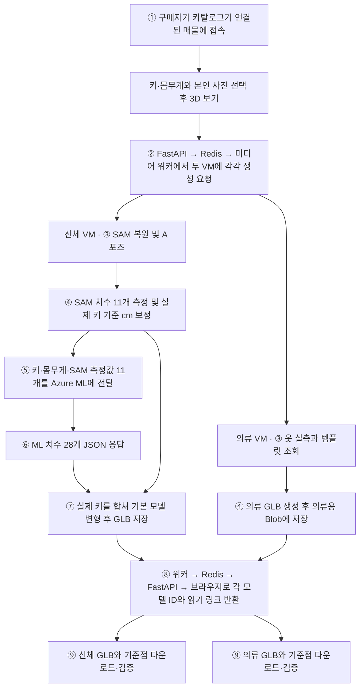

# 입어봄 V2 · 신체와 의류 3D 모델 생성 순서

웹 FastAPI의 요청·응답 JSON과 실제 VM 연결 설정은 [3D FastAPI 연결 계약](3d-fastapi.md)을 참고합니다.

**① 접속 → ② 신체·의류 VM에 각각 요청 → 신체 ③~⑦ / 의류 ③~④ 동시 진행 → ⑧ 모델 ID·링크 받기 → ⑨ Blob에서 GLB 받기**



②에서 두 VM의 작업을 함께 시작한다. 각 VM은 자기 파일의 저장이 끝난 뒤 모델 ID와 읽기 링크를 돌려준다. 최신 프론트는 fit-room.js가 결과를 받고 pair-files.js로 검증한 뒤 tryon-glb.js로 신체와 옷을 정렬해 착장 모델을 만든다. 의류가 실패하면 신체만 표시할 수 있지만 신체가 실패하면 착장을 표시하지 않는다. 삭제된 model-pair.js는 사용하지 않는다.

## 팀 서비스 연결

3D팀 Dockerfile의 실행 대상은 신체 `avatar`(컨테이너 포트 8001)와 의류 `garment`(8002)다. V2 환경 변수에는 팀이 배포한 각 서비스의 모델 생성 경로까지 포함한 URL을 넣는다. [전달받은 Dockerfile·의존성과 연동 준비 사항](../../docs/3d/README.md)

미디어 워커에 아래 네 환경 변수를 설정한다. VM 주소에는 실제 모델 생성을 받는 POST 엔드포인트 전체를, Blob 주소에는 해당 모델 종류에 허용할 컨테이너의 기본 URL을 지정한다. 브라우저는 ⑨에서 해당 Blob을 직접 읽으므로 각 컨테이너의 CORS 규칙에 웹앱의 출처를 허용해야 한다.

| 종류 | VM 엔드포인트 | 허용할 Blob 컨테이너 |
|---|---|---|
| 신체 | `BODY_MODEL_VM_URL` | `BODY_MODEL_BLOB_BASE` |
| 의류 | `GARMENT_MODEL_VM_URL` | `GARMENT_MODEL_BLOB_BASE` |

신체 VM은 바이트 본문으로 JPEG/PNG 사진을, 헤더로 키(cm)와 몸무게(kg)를 받는다. SAM A 포즈 표면을 측정한 뒤 키·몸무게와 SAM cm 측정값 11개를 Azure ML 실시간 엔드포인트에 JSON으로 전달하고 예측 치수를 JSON으로 받는다. 의류 VM은 선택한 `garment_id`와 `size_id` 두 정수를 받으며 item_code 조회도 지원한다. 둘 다 로그인 프록시의 계정 ID가 필요하다. VM 응답은 `{"status":"ready","model_id":"<GLB SHA-256>","urls":{"model.glb":"…","anchors.json":"…"}}`이며 신체 응답에는 `measurements.json` 링크도 있다. 브라우저는 파일 단위 읽기 링크로 다운로드하고 GLB 해시와 기준점을 확인한다.

웹앱은 `POST /api/v2/model-pair`에서 Redis 작업 번호(HTTP 202)를 받고, 같은 로그인 계정으로 진행 상태를 조회한다. 팀 VM은 렌더링과 Blob 게시를 마친 뒤 HTTP 200으로 ⑧의 모델 ID와 링크를 반환한다. VM 응답 대기는 기본 420초이며 `MODEL_PAIR_VM_TIMEOUT_SECONDS`로 조정한다(최대 600초). Blob 읽기 링크는 팀 코드 기준 15분간 유효하다.

의류 상품·실측은 Azure SQL을 사용하며 신체·ML 사이에는 SQL 중계가 없다. V2 매물 저장소는 MySQL이고, 실제 상품·사이즈 ID는 판매자가 3D팀의 카탈로그에서 선택해 연결한다. 태그가 없거나 수선된 중고 옷은 판매자가 등록한 치수로 일반 핏을 비교할 수 있다.

구매자의 일반 핏 조회는 계속 Redis의 DB 워커에서 처리한다. 신체 입력 저장과 모델 생성은 구매자가 매물에서 **내 몸과 이 옷을 3D로 보기**를 요청했을 때 시작한다. 기존 판매자 사진 측정 연동은 `GARMENT_MEASUREMENT_URL`을 사용한다.

테스트용 Redis가 있다면 `web/`에서 아래 명령으로 병렬 호출부터 두 GLB 다운로드까지 확인할 수 있다. 이 테스트는 전용 키 접두사와 로컬 VM·Blob 대역을 사용한다.

```bash
V2_INTEGRATION_REDIS_URL=redis://127.0.0.1:6380/13 python -m unittest discover -s tests
```
